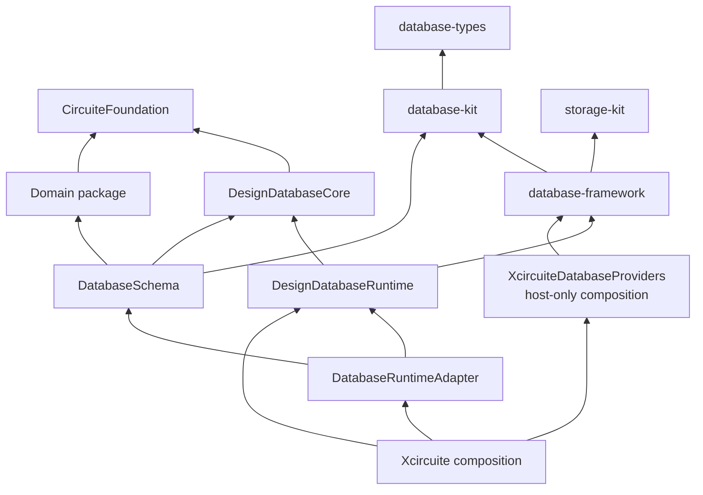
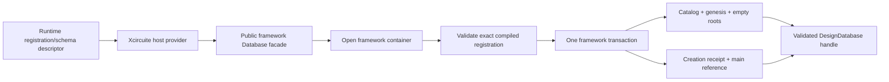
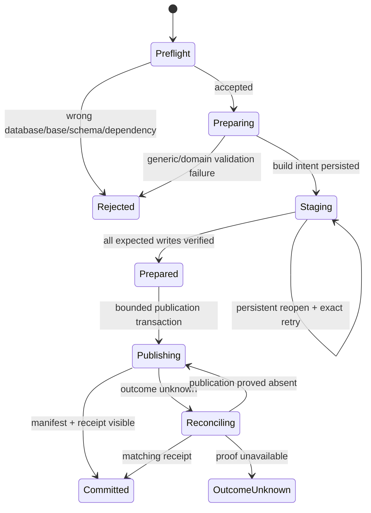
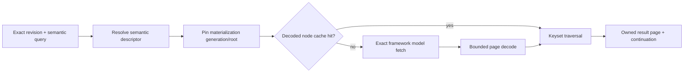

# Database Framework Runtime Architecture

Status: normative target design / bounded candidate staging-resume and contributed
projection bootstrap/query/path-copy increments implemented.

This document defines how `DesignDatabaseRuntime` uses the existing public API of
`database-framework`. It replaces every earlier design that required an upstream
framework patch, a private API, a DesignDatabase-owned raw `storage-kit` bootstrap
plane, or a second generic database runtime.

The package now pins the reviewed fixed framework release and exposes a callable
`DesignDatabaseRuntime` bootstrap path. Immutable contributions are composed once,
the framework validates complete entity schema equality, and a host-provided
`DBContainer` is accepted only after canonical schema fingerprint validation. Physical
runtime registration identity remains separate from the semantic schema bundle fixed by
a revision. Catalog, genesis revision, `main`, capabilities, exact ordered schema-bundle
members, runtime registration, and a scoped creation receipt are published in one
framework transaction with replay, status lookup, and exact reconstruction on open.
Named-reference CAS and retention activation/release use separate bounded transactions,
one global scoped operation claim namespace, complete receipts, and status reconciliation.
Candidate submission now validates canonical plan/request digests, exact base schema,
dependency-root and semantic-graph bindings, then delegates exact-base admission
validation to registered domain adapters before claiming the operation. Runtime persists
the exact bounded `DesignCommitSubmission` capsule and the adapter's opaque
validated-input directory in the same framework transaction as the global operation
claim and permanent identity reservation. Every post-claim path can recover the exact
plan without caller state and uses synchronous deterministic materialization from the
persisted validated capsule; it cannot query canonical state, invoke tools, emit events,
or repeat domain validation. Runtime
then persists a request-bound `DesignCommitBuildIntentModel`, stages at most 64 immutable
domain writes per framework transaction, stages immutable projection nodes in separate
bounded transactions, and advances authenticated progress in the same transaction as
each batch. A final bounded transaction verifies prepared state and publishes only
projection descriptors/bindings, the immutable candidate manifest, the terminal intent,
and its receipt. Persistent SQLite close/open fixtures cover interruption before intent
publication and during staged writes without exposing an incomplete revision. Revision
manifests and commit outcomes persist a canonical ordered facet-root
directory. Exact snapshots own an explicit lease, expose those roots, pin verified
materializations, and execute cumulative-budget exact keyset pages or closure-scoped
bounded Runtime model reads. Permanent entity/occurrence allocation, canonical
entity/occurrence records, adapter change digest binding, absent-family bootstrap, and
unchanged-root inheritance are implemented. Existing-family changes validate the exact
base value and update immutable physical-codec-v2 B+trees by root-to-leaf path copy,
including split, sibling merge/repartition, and root collapse. Real domain object
projection mappings, abandoned-staging reclamation, the complete unknown/corruption
recovery matrix, decoded cache, and GC remain unimplemented. Relation occurrence
changes already require complete outgoing/incoming pairs on both sides of insertion,
update, target move, or deletion. The Native dictionary backend remains the semantic
reference.

## 1. Fixed Dependency Decision

`database-framework`, `database-kit`, `database-types`, and `storage-kit` are fixed
external dependencies from the perspective of LSI.

DesignDatabase:

- pins reviewed releases or commits for the complete stack;
- uses only supported public APIs;
- does not change, fork, patch, vendor, or copy the framework;
- does not import private declarations;
- does not call `storage-kit` directly;
- does not recreate generic transaction, query, index, migration, or service execution;
- returns a typed unsupported capability when its required semantics cannot be
  implemented safely with the fixed public contract.

The current external framework working tree was reviewed after its owner fixed two
generic correctness defects:

1. runtime registration now validates complete compiled entity schema equality instead
   of accepting a name-only match;
2. malformed persisted index lifecycle state is a typed failure and is not rounded to
   a default state.

The current DesignDatabase package pins the reviewed release and consumes only its
public `Database` product. DesignDatabase does not duplicate or override the fixed
framework's generic schema and index-state validation.

## 2. Ownership Comparison

| Concern | Database stack owner | DesignDatabase owner |
|---|---|---|
| Primitive persisted values | `database-types` | Mapping of design IDs/digests to those values |
| Models, fields, relationships, query declarations | `database-kit` | Design-specific persisted model declarations |
| Transactions and retries | `database-framework` | Which design roots must publish atomically |
| Generic schema/runtime validation | `database-framework` | Exact design schema-root and revision binding |
| Generic indexes and query execution | `database-framework` | Revision-scoped semiconductor projection models and query semantics |
| Physical backend | `storage-kit` through framework composition | None |
| Physical schema migration | `database-framework` | No duplicate migration engine |
| Design facet migration | Domain adapter plus DesignDatabase candidate commit | Atomic new revision and schema-root publication |
| Service execution | `database-framework` | Exact-revision service adapter |
| Workspace mount/backend selection | None | `Xcircuite`, not DesignDatabaseRuntime |

The two designs are compatible. `database-framework` executes generic database
operations. DesignDatabase adds one application schema and the semantics of immutable
design revisions.

## 3. Compile-Time Products



| Product | Responsibility |
|---|---|
| `DesignDatabaseCore` | Backend-neutral revision, dependency, snapshot, plan, query, page, and error contracts |
| `DesignDatabaseRuntime` | Framework-backed persisted models, exact revision resolution, plan admission, projection traversal, and receipt handling |
| `<Domain>DatabaseSchema` | Domain models, database representation, cross-facet constraints, and validation adaptation |
| `<Domain>DatabaseRuntimeAdapter` | Mechanical contribution to one runtime registration bundle |
| `XcircuiteDatabaseProviders` | Xcircuite-owned host package that maps a provider profile to the public framework `Database` facade and returns a ready framework container/session |
| `Xcircuite` | Backend/provider profile selection, location, credentials, mount lifetime, Runtime attachment, and multi-database session composition |

`DesignDatabaseInfrastructure` and `DesignDatabaseSQLite` are intentionally absent.
Backend-specific host composition uses public facade operations such as
`DBContainer.sqlite` or `DBContainer.open` from `database-framework`. Neither
DesignDatabase nor the Xcircuite host provider imports or calls `storage-kit` directly.
The provider does not define canonical identity; it only realizes availability and
returns the container/session selected by Xcircuite policy.

## 4. Public Framework Surface Used

Runtime is built from the reviewed public contracts:

| Public framework capability | Runtime use |
|---|---|
| `Schema` and compiled entity runtime registration | Register the exact DesignDatabase and selected domain persisted models |
| `DBContainer` / `DatabaseContext` | Accept a host-opened framework container/context and execute model operations |
| Framework transaction execution | Atomic genesis, candidate, receipt, reference, retention, and cleanup transitions |
| Persistable model fetch/mutation | Read and write catalog, revision, page, lock, and operation models |
| Generic index/query operations | Bounded catalog, ID, status, and administrative lookup |
| Physical migration | Bring the persisted application schema to the pinned compiled schema before handle publication |
| Framework service facilities | Adapt exact single-database operations without exposing storage layout |

Two current framework read surfaces are intentionally constrained:

- the typed `QueryCursor` uses a query fingerprint plus logical offset and may rescan
  preceding rows when its access path cannot push the offset down;
- `IndexReadResult` owns a complete row array.

They are therefore allowed for bounded control-plane tables only. Circuit-scale
entity/relation/spatial/change traversal does not claim bounded keyset performance
through those APIs.

## 5. Persisted Application Models

All DesignDatabase state is stored as ordinary framework-managed models. There is no
raw key namespace or storage-engine codec owned by DesignDatabase.

### 5.1 Catalog and schema

| Model | Purpose |
|---|---|
| `DesignDatabaseCatalogModel` | Exact database ID, format contract, genesis revision, feature-capability profile, and creation request digest |
| `DesignSchemaBundleModel` | Content-addressed exact domain schema bundle |
| `DesignSchemaBundleMemberModel` | Ordered schema members, dependencies, versions, and canonical digests |
| `DesignRuntimeRegistrationModel` | Digest of the exact compiled registration bundle accepted for the database |

### 5.2 Revision and dependency

| Model | Purpose |
|---|---|
| `DesignRevisionManifestModel` | Revision, parents, state/schema/dependency/change/facet roots, projection semantic descriptors/digests, and provenance; no physical page root |
| `DesignRevisionLifecycleModel` | Implemented authenticated visible, deleting, or collected state with monotonic reachability generation and typed visibility checks; atomic exact-candidate deletion admission is implemented and permanent collection completion remains pending |
| `DesignRevisionParentModel` | Explicit DAG edge |
| `DesignDependencyLockModel` | One revision's exact direct dependency set |
| `DesignDependencyEntryModel` | Role, exact revision/content target, required schema/feature capability, interface digest, immutable retention-contract identity |
| `DesignNamedReferenceModel` | Reference name, exact revision or tombstone, and generation |
| `DesignRevisionRetentionModel` | Active or released-tombstone reachability claim, exact revision, generation, reason/evidence, and non-reusable claim identity without approval policy |

### 5.3 Semantic data and projections

| Model | Purpose |
|---|---|
| `DesignProjectionSemanticDescriptorModel` | Boundary-independent digest, count, key bounds, and semantic version for one revision/family |
| `DesignProjectionBindingModel` | CAS-controlled current materialization generation for one revision/family/semantic digest |
| `DesignProjectionMaterializationModel` | Immutable physical codec/profile/generation/root and build verification state |
| `DesignProjectionRetirementModel` | Durable superseded/deleting/collected lifecycle for a non-current materialization generation |
| `DesignProjectionNodeModel` | One bounded content-addressed balanced-tree internal or leaf node containing a canonical semantic key range |
| `DesignProjectionBuildIntentModel` | Idempotent preparation identity, semantic input, physical profile, budgets, authenticated progress root, and expected output |
| `DesignProjectionPublicationReceiptModel` | Proves which semantic descriptor and physical generation/root were atomically published by which operation |
| `DesignProjectionGCEpochModel` | Persisted reachability generation, maintenance-authority instance, observed lease snapshot, and root-set digest for one mark/sweep epoch |
| `DesignProjectionGCStateModel` | Bounded resumable administrative frontier bound to a GC epoch; never a design-query continuation |
| `DesignCollectionIntentModel` | Implemented authenticated operation/request-bound exact revision candidate set, original-root-set digest, reachability/lease observation binding, atomic admission creation, exact-operation reconciliation, lifecycle state, and bounded startup admission reconstruction; policy-retained roots, sweep progress, and terminal receipt remain pending |
| Facet data node family | Revision-visible domain records and columns |
| Entity directory node family | Stable entity ID to facet-node lookup |
| Relation occurrence node family | Stable occurrence IDs, owners, targets, order, and typed attributes |
| Name/hierarchy/connectivity node families | Canonically ordered bounded semantic lookup |
| Spatial candidate node family | Signed-DBU conservative bounds by container and explicit layer |
| Cross-facet/dependency node families | Stable occurrence-based identity and invalidation lookup |
| Direct change node family | Typed key/before/after records from one manifest state base |

Semantic and physical identity are separate:

- the revision manifest hashes a canonical ordered semantic-sequence digest whose
  accumulator is independent of page boundaries, codec, compression, fanout, and
  physical packing;
- semantic format v2 accumulates two domain-separated SHA-256 entry contributions
  modulo 2^256 and finalizes family, semantic version, unique-key entry count, and both
  accumulator values through a separate domain-separated SHA-256 digest; insert,
  update, and delete therefore change semantic identity without rereading unchanged
  pages;
- a materialization binding maps that semantic digest to one immutable physical
  generation/root;
- physical codec v2 node identity hashes physical codec/profile, projection family,
  canonical key bounds, subtree entry/node counts, child identities, and physical
  payload;
- repacking or rebuilding publishes a new verified binding generation without changing
  the design revision or state digest;
- a snapshot pins one binding generation, and its continuation cannot move to another.

Node payload size is capped below the reviewed framework model value budget; oversized
semantic records fail typed or use an explicitly designed chunked owner model. The
initial candidate becomes queryable only when one publication transaction binds the
complete semantic descriptors, initial materialization generations/roots, matching
intent, and publication receipt.

### 5.4 Operation and recovery

| Model | Purpose |
|---|---|
| `DesignCreationOperationModel` | Idempotent create identity, request digest, and complete outcome |
| `DesignCommitOperationModel` | Plan/base/schema/dependency binding, state, candidate, and complete outcome |
| `DesignCommitSubmissionModel` | Implemented exact operation/request/plan-bound canonical submission capsule; attachment open bounded-scans build intents and revalidates capsule payload plus semantic plan/request digests before serving handles |
| `DesignCommitBuildIntentModel` | Implemented request/plan/base/candidate/prepared-directory/staging binding, expected and completed domain/projection write counts, authenticated progress digest, and staging/prepared/committed/rejected state |
| `DesignPreparedMutationDirectoryModel` | Exact operation/request/plan-bound prepared metadata, projection changes, canonical roots, adapter identity, and authenticated payload used for pure restart restoration |
| `DesignReferenceOperationModel` | Expected generation/revision, desired revision, and complete CAS outcome |
| `DesignRetentionOperationModel` | Retain or exact revision+generation CAS release request, request digest, authorization result, and complete reconcilable outcome |
| `DesignStagingRootModel` | Implemented authenticated active/published/rejected exact operation/request/plan/candidate/staging root bound to monotonic reachability generation |
| `DesignCleanupOperationModel` | Idempotent semantic GC request and result |

Operation records distinguish completed, rejected, conflicting, cancelled, and outcome
unknown states. A connection loss never becomes a guessed success or failure.
Each operation record is keyed by database, a non-secret authenticated subject-scope ID,
and local operation ID. This complete reference supports caller-owned status
authorization; credentials and bearer material are never persisted in revision state or
operation models. The same local operation ID may exist in another subject scope, so
status and submission cannot reveal a cross-subject global collision.

Retention activation and release use different operation IDs, the same non-reusable
claim identity, and request-digest-bound outcomes. Release leaves a tombstone, verifies
the exact revision and claim generation, and atomically increments
`reachabilityGeneration`. `retentionStatus` reconciles an unknown response before a
caller retries or advances policy. Releasing a claim removes one semantic root; it never
directly deletes a revision or page.

## 6. Creation and Open

### 6.1 Creation

Creation uses the framework's public schema/runtime and transaction APIs.



The caller fixes database ID, genesis revision ID, creation operation ID, initial schema
bundle, feature-capability set, and request digest before the mutation.

The host provider keeps framework security enabled and admits
`DesignDatabaseRuntimeStorageSecurity.administratorRole`. This role is an internal
storage capability, not a DesignDatabase caller grant. `DesignDatabaseRuntimeProvider`
first resolves the caller's typed grants and subject scope, then installs the matching
task-local framework principal only for the bounded storage operation. A provider that
omits the role fails typed; disabling framework security is not a production fallback.
Runtime clears the internal role before invoking public authorization or domain
validation/materialization callbacks. A validator can access canonical state only
through its bounded Runtime read and semantic-query contracts, which reacquire the role
for their private framework operation and restore the unprivileged callback context on
return. Registered immutable writes execute inside the Runtime-owned transaction passed
to the adapter and cannot choose a backend or container.

One framework transaction:

1. checks whether a DesignDatabase catalog already exists;
2. rejects a different database identity or request;
3. inserts the catalog and exact schema root;
4. inserts the genesis revision with empty projection semantic descriptors and initial
   empty materialization bindings;
5. inserts the initial `main` reference;
6. inserts a complete idempotent creation outcome.

An identical operation returns the same genesis. A conflicting operation fails typed.
No create-or-open ambiguity is exposed by the DesignDatabase provider.

### 6.2 Open

Open:

1. receives a ready container/session created by the Xcircuite-owned host provider
   through the public framework `Database` facade;
2. lets the framework validate and migrate its persisted application schema;
3. validates the complete compiled runtime registration bundle;
4. reads the DesignDatabase catalog by its supported model API;
5. compares the expected database ID and format;
6. verifies the exact schema bundle, feature-capability profile, genesis, required reference,
   and projection model readiness;
7. publishes a DesignDatabase handle only after all checks pass.

A wrong database, missing catalog, unsupported format, schema mismatch, malformed index
state, or corrupt revision root is a typed open failure. Runtime closes the rejected
container according to the framework's public lifecycle contract. It does not repair or
replace state implicitly.

Framework migration may change physical model representation. It never changes an
existing DesignDatabase revision's semantic identity. Domain facet migration is a
separate candidate-producing design operation.

## 7. Exact Revision Representation

The framework's storage transaction snapshot or model version is not a
`DesignRevisionID`.

A DesignDatabase revision is an explicit immutable application manifest with:

- exact parent revisions;
- exact schema and dependency roots;
- exact facet roots;
- exact projection semantic descriptors and boundary-independent digests;
- exact direct change root;
- canonical state digest;
- provenance and retained evidence references.

Opening a snapshot resolves one manifest, resolves each required semantic descriptor to
one verified physical binding generation, and pins those immutable materialization roots
for the snapshot lifetime. Multiple snapshots may share immutable nodes or pin different
physical generations with identical semantic digests. Closing one snapshot cannot
invalidate another.

## 8. Plan-First Candidate Commit

The public production API accepts an immutable plan. It does not execute an arbitrary
caller closure inside a framework transaction.



### 8.1 Plan binding

Each plan binds:

- one database ID;
- one exact base revision;
- the base schema root;
- the base direct-dependency root;
- one local operation ID and request digest, qualified by the handle's exact database and
  stable authenticated subject scope at admission;
- bounded semantic operations or content-addressed chunks;
- provenance and explicit resource budgets.

A plan containing another database's mutation is rejected. Cross-database snapshots may
be input evidence, but only their exact references and resolved dependency-graph digest
are recorded.

### 8.2 Preparation

Runtime performs asynchronous reads and domain validation outside a retrying write
closure. It:

- validates the exact base manifest and dependency root;
- resolves provisional entity and occurrence identities;
- computes boundary-independent projection semantic descriptors;
- bulk-builds an absent family or path-copies only affected nodes of an existing
  immutable balanced physical projection for the selected profile;
- invokes the domain-owned, database-independent pure validator through the schema
  adapter's bounded
  proposed-overlay context;
- computes canonical roots and direct changes;
- persists a request-bound build intent and stages immutable domain records and
  projection nodes while atomically advancing expected-count progress.

Each node write is fixed before entering a framework transaction. The Runtime atomically
persists the exact prepared-mutation directory with the build intent. Every bounded
staging transaction then inserts idempotent nodes and advances the authenticated intent
progress root; neither side may become visible without the other. Attachment open first
performs a bounded scan of build intents, reloads each exact submission without caller
state, and validates its operation/request/plan/base/candidate/progress binding. Resume
then validates the prepared-directory payload digest, adapter version, roots, write
count, and projection changes before using the adapter's synchronous restoration path.
It does not reinvoke validation, exact-base queries, tools, diagnostics, or event sinks.
A claim with permanent identity reservation but no atomic submission or validated-input
capsule is corruption, not a resumable success.

The implemented intent and active staging root prevent a partial candidate revision from
becoming visible and support deterministic close/open resume. The root is atomically
created with the intent and reachability-generation advance, then terminalized as
published or rejected with candidate publication. Abandoned-root admission, physical
record deletion, and resumable collection are not implemented; unreachable staged
records and nodes remain until that collection/GC protocol is complete.

### 8.3 Publication

One bounded framework transaction verifies:

- the operation and request identity;
- exact base/schema/dependency preconditions;
- every prepared semantic descriptor, physical binding generation/root, and digest;
- candidate identity uniqueness;
- complete required projection semantic descriptors and initial verified
  materializations.

It then inserts the immutable semantic revision manifest, initial materialization
bindings, direct change root binding, complete commit outcome, and the transition that
terminalizes the build intent and makes staged roots revision-reachable. It does not
update `main`.

Repacking an existing revision is a separate materialization operation. It proves the
same semantic descriptor, stages a new physical generation, and CAS-publishes only the
binding plus receipt. Existing snapshots retain their prior generation. It never changes
the revision manifest, state digest, dependency lock, or named reference.

Named-reference promotion is a separate framework transaction with exact expected
revision and generation. Approval and authorization remain outside DesignDatabase.

## 9. Circuit-Scale Query Path

DesignDatabase high-volume queries traverse immutable physical materializations proven
equivalent to the revision's semantic descriptors.



The continuation binds:

- database and exact revision;
- schema and projection semantic version/digest;
- exact materialization binding generation, physical codec/profile, and root;
- normalized semantic query;
- canonical order and last consumed key;
- page and whole-query budgets;
- result/candidate/work/node-fetch/encoded-read-byte/decoded-retained-byte/output-byte
  counters observable by DesignDatabase;
- completion reason.

It never stores only an offset. Resume starts at the exact tree/search key and does not
scan or hash prior pages.

The hot path uses the fixed public
`DatabaseTransaction.fetch(_:identifiedBy:consistency:)` operation to retrieve one exact
content-addressed node by identity. It does not discover projection nodes through a
table scan. Parent nodes contain exact child identities and canonical separator keys, so
tree descent has bounded fan-out and deterministic I/O.

### 9.1 Balanced tree invariant

Every physical materialization is an immutable copy-on-write B+tree with a declared
physical profile:

- all leaves occur at one depth;
- leaf entries are strictly ordered by the complete canonical semantic key;
- internal child ranges are ordered, non-overlapping, and exactly cover their declared
  parent range;
- non-root internal nodes satisfy declared minimum and maximum fanout, and non-root
  leaves satisfy declared minimum and maximum occupancy after publication;
- the root is either one leaf or has at least two children;
- split, merge, and deletion rebalancing restore occupancy before binding publication;
- point updates and bounded splices path-copy only affected root-to-leaf paths and share
  every unchanged node;
- canonical bulk build emits the same semantic digest regardless of physical profile;
- publication verifies entry count, key bounds, equal leaf depth, child-range coverage,
  occupancy, node byte limit, and semantic digest.

For `N` entries, declared minimum fanout and leaf occupancy impose a checked height bound.
Lookup and keyset restart are `O(log N)` node fetches, and a result page is
`O(log N + visited nodes for the requested page)`. A tree that violates the bound is
corrupt or unqualified; Runtime does not traverse it as a fallback.

### 9.2 Projection families

| Projection | Canonical page key |
|---|---|
| Entity | Entity ID |
| Name | Interned/normalized name plus entity ID |
| Hierarchy | Matched owner plus occurrence identity |
| Connectivity | Matched endpoint, relation kind, owner, semantic order, target, occurrence ID |
| Spatial | Container, explicit layer scope, entity, stable entry ID |
| Cross-facet | Direction, matched endpoint, occurrence identity |
| Direct change | Entity, subject family/payload, change kind |
| Dependency | Exact source/target binding plus occurrence identity |

Spatial pages return conservative candidates. The physical domain adapter performs exact
geometry refinement. Multi-hop graph algorithms remain Engine-owned unless a future
explicit bounded traversal contract is implemented with the fixed framework surface.

### 9.3 Bounded framework use

Framework generic query/cursor/index APIs remain useful for:

- exact or tightly bounded catalog lookup;
- operation status;
- named references;
- retention and administrative records;
- small compatibility metadata.

Runtime does not route a circuit-sized query through a materialized `IndexReadResult` or
an offset cursor and then claim keyset or bounded memory behavior.

`DatabaseTransaction.scan(_:in:after:limit:consistency:)` is limited to explicitly
bounded catalog, GC, retention, and repair enumeration. Its storage-key continuation is
persisted only in the matching administrative operation record and is invalidated if the
operation's database, model registration, partition, or root assumptions change. It is
not exposed as a semantic design-query continuation.

## 10. Cache and Copy Contract

`DesignDecodedPageCache` is an optional Runtime component:

- key: physical node digest, physical codec/profile, and materialization generation;
- value: immutable owned decoded page;
- isolation: sharded `Mutex<State>` for short in-memory lookup/accounting;
- I/O and decode: outside the lock;
- eviction: byte-budgeted and lease-aware;
- sharing: safe across exact snapshots because pages are immutable.

The first implementation remains safe and bounded. It may copy one encoded page into one
decoded owner. It does not claim zero copy.

A later optimization may use `database-types` owned byte buffers and closure-scoped
views only when:

- page owner and borrow lifetime are explicit;
- pointers cannot escape;
- decoded and reference results are differential-equivalent;
- allocations and copied bytes improve on a retained workload;
- sanitizer and boundary tests pass.

### 10.1 Staging and generation-fenced GC

Catalog reachability has a monotonic `reachabilityGeneration`. Every transaction that
creates/removes a named reference, activates/releases a durable retention claim,
creates/removes an active build-intent root,
revision publication, materialization binding, or binding-retirement record increments
it. Opening a read snapshot does not write database state.

One qualified maintenance authority also owns an ordered ephemeral lease coordinator.
Snapshot open first registers a pending exact-revision lease, resolves the manifest and
binding generation, then finalizes the lease; failure removes the pending lease. The
coordinator tracks active revision/query/materialization leases, a monotonic lease
observation counter, and candidate-set-scoped deletion admissions. It contains no
provider path, credential, or canonical revision state. The observation counter is audit
evidence, not a global sweep precondition.

Every exact snapshot open checks `DesignRevisionLifecycleModel` after pending-lease
registration and before returning a manifest or binding. `deleting` and `collected`
return typed unavailable/collected results. Named-reference, retention, dependency
publication, and materialization-binding operations cannot make a deleting/collected
revision visible again.

The staging and collection protocol is:

Steps 1 through 3, durable visible lifecycle creation, attachment-wide pending/active
snapshot lease ownership, and exact-candidate collection admission are implemented.
Admission bounded-audits the currently persisted DesignDatabase-owned roots: named
references, active retentions, nonterminal commit bases, parent closure, and
same-database dependency closure. It rejects a leased, rooted, or already-admitted
target, fences new target leases, and leaves unrelated revisions available. One bounded
framework transaction rechecks reachability and atomically persists the exact operation
claim and authenticated intent, transitions every candidate from visible to deleting,
and advances reachability. Exact retries reconcile the persisted claim/intent; unknown
transactions do not authorize physical deletion without that reconciliation. Attachment
startup verifies operation, request, candidate, reachability, state digest, and lifecycle
before reconstructing nonterminal admissions. Policy-retained receipt roots and the
physical progress/terminal work in steps 7 and 8 remain pending; step 9's admission
reconstruction foundation is implemented, but resumable mark/sweep progress is not.

1. the first staging transaction creates an active build intent and authenticated empty
   progress root while advancing reachability generation;
2. every later staging transaction inserts a bounded idempotent node set and advances
   the authenticated progress root in the same transaction;
3. candidate or repack publication verifies the final intent root and atomically
   publishes binding/receipt while terminalizing the intent;
4. GC begins by recording an epoch ID, exact persisted reachability generation,
   maintenance-authority instance, observed lease snapshot, and a digest of
   named-reference, active-retention, policy-retained-receipt, active-build-intent,
   published-dependency, and active-snapshot/query-lease roots. Reachable revision
   manifests then lead to their current
   bindings; a manifest is not a root merely because its row exists;
5. its model-scan continuation is valid only for that epoch, registration, partition,
   and reachability generation;
6. before deleting any node for a semantic revision/current materialization, Runtime
   obtains a bounded candidate-set admission token only when no pending or active lease
   covers it. In one framework transaction it then rechecks persisted reachability,
   creates an operation-identified collection intent containing the original entry
   roots, transitions the revision lifecycle from visible to deleting, records the
   complete admission outcome, advances reachability generation, and stores that
   post-admission generation in the intent. If this transaction fails or is unknown, no
   node deletion begins until status reconciliation;
7. the deleting lifecycle is the durable discoverability fence. Runtime holds or
   reconstructs the candidate-set admission through the identity's entire collection
   intent, not one node batch. Each bounded delete transaction verifies that exact
   intent/lifecycle and persisted reachability generation. New snapshot/query leases for
   only those identities fail typed; unrelated lease open/close does not invalidate the
   sweep or prevent progress;
8. the terminal framework transaction verifies the intent and generation, removes the
   remaining discoverable manifest/binding entries, writes a permanent collected
   lifecycle tombstone plus terminal receipt, and completes the intent. Only then may
   the ephemeral admission token be released. Revision and claim identities are never
   reused;
9. after an authority restart, Runtime discovers every nonterminal persisted collection
   intent and reconstructs its deletion admissions before accepting snapshot opens. It
   discards an unadmitted mark frontier, but never re-exposes or silently abandons a
   deleting identity. It resumes or rebuilds the authenticated frontier from the
   intent's original roots and current reachable-node mark; corrupt or unreconcilable
   intent state remains typed unavailable for repair.

Collection intents are maintenance access records, not live semantic reachability roots.
Their authenticated progress distinguishes already deleted ranges from unexpected
missing/corrupt nodes during restart. Each delete batch removes only nodes absent from
the current live-root mark at the intent's post-admission reachability generation.

For a retired physical generation of a still-visible revision, the already-committed
binding CAS plus `DesignProjectionRetirementModel` is the durable discoverability fence;
new snapshots can select only the current binding. Collection admission still waits for
all snapshots that pinned the retired generation, persists a collection intent before
node deletion, and follows the same restart/terminal-receipt rules without tombstoning
the live semantic revision.

Therefore a storage-key continuation alone never authorizes deletion. Nodes staged after
the mark cannot be swept, reused old nodes cannot race a new binding, and unreachable
physical generations can be collected without changing semantic revision identity.
Local/direct profiles allow one maintenance authority; shared profiles route snapshots
and GC through one qualified service authority or return typed unsupported maintenance.
They do not add a hidden database write to every read.

GC liveness evidence includes continuous unrelated-reader churn while an unreachable
candidate is collected, plus a targeted open/close race that safely skips or aborts only
the pre-admission candidate. Delete batches are bounded; once durable lifecycle admission
succeeds, reads of that unreachable identity fail typed rather than observing partial
storage.

## 11. Workspace and Multi-Database Boundary

Runtime opens one DesignDatabase. It does not own workspace mounts or federated
transactions.

Xcircuite:

- maps provider profile plus logical locator to a public framework factory;
- validates the expected database ID;
- opens one selected write target and exact read-only dependencies;
- resolves the transitive dependency graph;
- supplies exact snapshot sets to domain engines;
- records run actions, candidate references, and evidence;
- closes every handle/session.

The provider owns backend security configuration. Its container remains private to
DesignDatabaseRuntime and must admit the Runtime storage role while keeping framework
security enabled. Public `read`, `proposeCandidate`, `promoteReference`, `retain`,
outcome-inspection, and administration decisions remain DesignDatabase authorization
contracts and are checked before the internal storage boundary is entered.

The host-owned `XcircuiteDatabaseProviderSession` owns the public-framework container.
Each Runtime attachment and database handle holds a strong session lease; a provider
session cannot finish while a child handle, snapshot, page, or operation remains live.
Shutdown first rejects new children, then cancels and drains pages/operations and
snapshots, closes database handles, detaches Runtime, and finally closes the framework
container. Every cleanup failure is aggregated into structured termination evidence.
If a framework provider profile cannot make this lifecycle observable, that profile is
typed unsupported rather than wrapped with detached cleanup or direct storage access.

Every mutating command targets one database only. A repair loop is an orchestrator that
records a sequence of child mutation operations; each child has one target, one exact
base, and one candidate. It is not one multi-database transaction.

## 12. Service Boundary

The service surface preserves the same single-database semantics:

- explicit database session;
- schema/feature-capability negotiation plus separate authorization grants;
- exact snapshot open and close;
- bounded semantic page query;
- immutable plan upload and status;
- candidate result;
- named-reference read/CAS/status;
- operation-identified retain/release and retention status;
- caller-owned outcome inspection bound to authenticated subject/scope, with separate
  administrator reconciliation;
- typed cancellation, deadline, authorization, and resource failure.

Large pages use a versioned bounded binary contract owned by DesignDatabaseCore.
Transport and hosting remain outside Runtime. Remote clients do not receive physical
model names, storage keys, SQLite paths, or backend handles.

## 13. Failure Contract

Runtime distinguishes:

- fixed framework version/API mismatch;
- missing runtime registration;
- compiled/persisted schema mismatch;
- wrong or missing DesignDatabase catalog;
- database identity mismatch;
- unsupported required feature capability;
- missing required authorization grant;
- corrupt index lifecycle or persisted model;
- unavailable/corrupt revision, schema, dependency, projection semantic descriptor, or
  physical materialization root;
- plan database/base/schema/dependency mismatch;
- resource or validation rejection;
- candidate conflict;
- commit outcome unknown;
- reference CAS conflict or outcome unknown;
- snapshot/page closed or expired;
- backend/service cleanup failure.

No case becomes an empty success, an implicit full scan, a different revision, an
open-or-create fallback, or a direct storage repair.

## 14. Performance Evidence

Required retained workloads measure:

- exact entity lookup;
- hierarchy and connectivity page traversal;
- spatial candidate plus domain refinement;
- dependency update and invalidation;
- plan preparation and publication;
- snapshot open and decoded-page cache behavior;
- direct change traversal;
- mixed readers and writer;
- service throughput and backpressure.

Artifacts include dataset digest, schema/projection versions, semantic digest, physical
profile/generation, backend profile, hardware, build, cache state, p50/p95/p99 latency,
throughput, peak memory, process allocations and copied bytes, framework calls,
DesignDatabase-observable node fetches/encoded-read/decoded-retained/output bytes, and
correctness digest. Full-process allocation/copied-byte evidence is a retained benchmark
measurement, not a continuation counter.

An unmet local SQLite workload does not authorize a framework patch. The team may:

1. improve DesignDatabase page layout/cache while preserving semantics;
2. select another supported framework backend through Xcircuite composition;
3. report the capability as unavailable for that profile.

The currently reviewed SQLite storage implementation owns one connection and admits
root transactions through one FIFO coordinator lease beginning with
`BEGIN IMMEDIATE`. Therefore it must not be documented as a concurrent-reader production
profile merely because immutable projection pages are read-only. Until retained
mixed-reader/writer and snapshot-lifetime workloads meet the profile budget, SQLite is a
developer/reference profile only. Xcircuite selects another supported backend for a
profile that requires concurrent read throughput, or returns a typed unsupported-profile
failure. DesignDatabase must not open a private connection pool or bypass the framework
to compensate. In the reviewed implementation, the snapshot read flag does not create an
independent SQLite reader/snapshot, and SQLite blob lifetime requires an owned copy at the
backend boundary; neither behavior is reported as zero-copy or concurrent-read support.

## 15. Implementation and Acceptance Order

| Order | Increment | Required evidence |
|---:|---|---|
| 1 | Exact pin and compatibility adapter for the reviewed fixed stack | clean dependency graph, public API compile, generic schema mismatch and corrupt-index failure tests |
| 2 | Framework-managed catalog/genesis/open | create/retry/conflict/wrong-ID/schema/migration/cleanup tests |
| 3 | Semantic revision descriptors, physical materialization bindings, dependency/reference/receipt models | semantic identity survives repack, codec, restart, corruption, DAG, CAS, unknown-outcome tests |
| 4 | Immutable plan preparation, atomic staging progress, and candidate publication | implemented prepared-directory binding, 64-write batching, persistent reopen pure restore, and directory tamper rejection fixture; remaining pre-intent interruption closure, no-partial-node, unknown-outcome, retained retry-exclusion, and full recovery evidence |
| 5 | Entity and relation-occurrence semantic pages | Native differential and stable identity/order tests |
| 6 | Name/hierarchy/connectivity/spatial/cross-facet/change/dependency pages | no-gap/duplicate, keyset resume, refinement, invalidation tests |
| 7 | Balanced-tree invariants, generation-fenced GC, decoded-node cache, and bounded result owners | height/occupancy/split/merge/path-copy, publication/GC race, crash resume, lifetime, eviction, memory/allocation/copy tests |
| 8 | First domain schema/runtime vertical slice | package isolation, round trip, schema migration, semantic failure tests |
| 9 | Xcircuite mount and exact dependency integration | multi-DB open, one-target mutation, cycle/unavailable/access tests |
| 10 | Service, CLI, remaining domains, retained performance qualification | protocol, restart, backpressure, benchmark, real-domain corpus |

Declarations, package targets, or successful empty operations do not satisfy these gates.
The production path is complete only when the framework-backed implementation exhibits
the same successful and failing design semantics as the Native reference and meets the
retained performance budgets.

## Owned container authority lifetime

An optional `DesignDatabaseRuntimeOwnedContainerProviding` facet transfers a prepared
`DesignDatabaseRuntimeOwnedContainer` resource to the attacher. The resource retains
its host-owned backing lease until Runtime has drained operations, closed snapshots
and shut down the container. Its `release()` completes the host cleanup and exposes
cleanup failure. The attacher owns the same release responsibility when registration
or persisted recovery admission fails.

Only a resource conforming to `DesignDatabaseRuntimeExclusiveMaintenanceContainer`
admits public revision collection. This resource contract requires exclusive access
among every participating open for the backing throughout its lifetime. The host
issues that resource after actual exclusion succeeds; a caller configuration boolean
or authorization grant cannot replace it. Legacy container providers remain usable
for ordinary operations but cannot collect revisions. Shared or remote profiles must
route every reader and collector through one qualified authority or remain unsupported.

```text
host backing exclusion -> owned container -> attachment recovery -> handle / snapshots
    -> bounded authenticated collection -> operations drain -> snapshots close
    -> container shutdown -> host authority release
```

The public maintenance adapter reuses the existing package admission, sweep and
startup recovery. Every collection request is bound to the handle database and
authenticated subject scope; administrator status may inspect another exact subject
operation in that database. One call performs at most one bounded sweep transaction.
Status validates persisted claim, intent and physical directory without deleting data.
Existing operation/intent digests and immutable schema rows retain their encoding.
