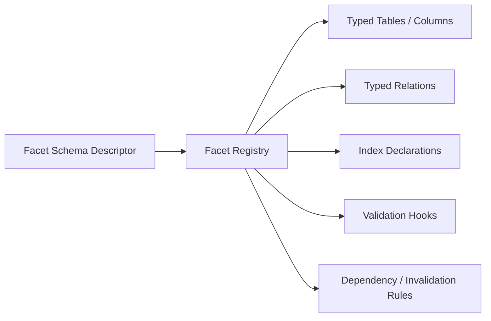
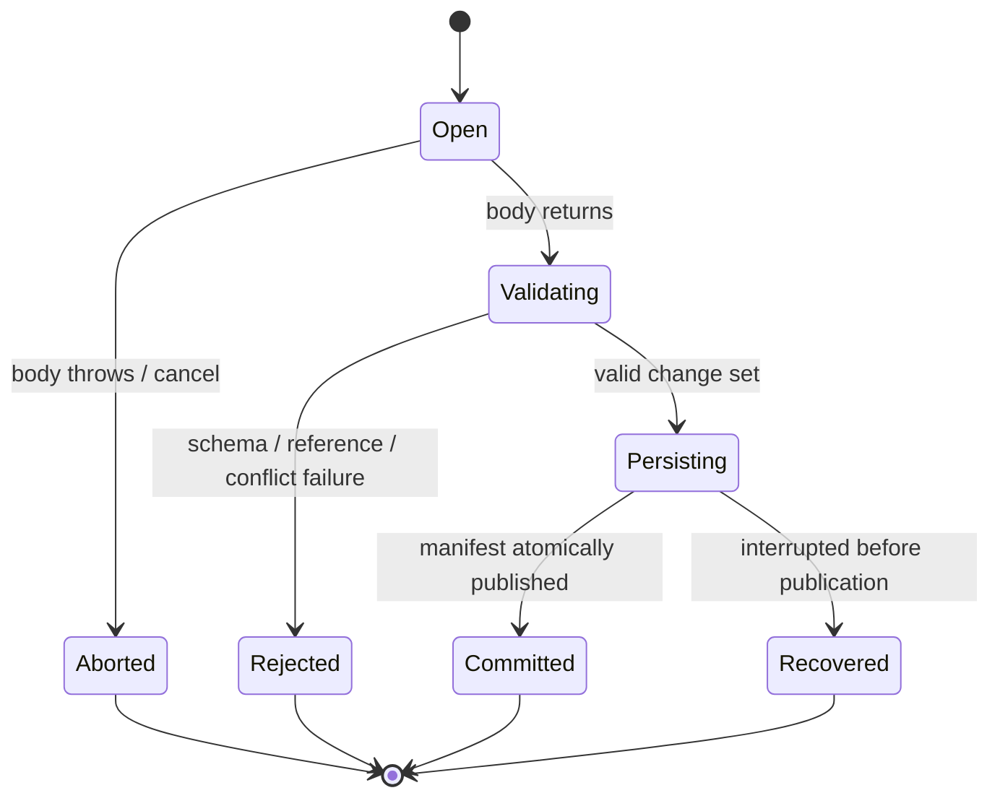
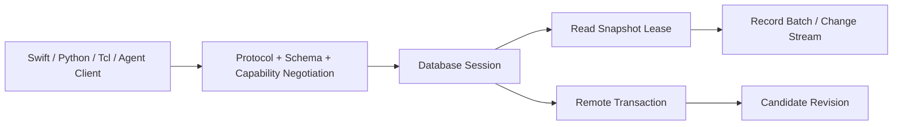
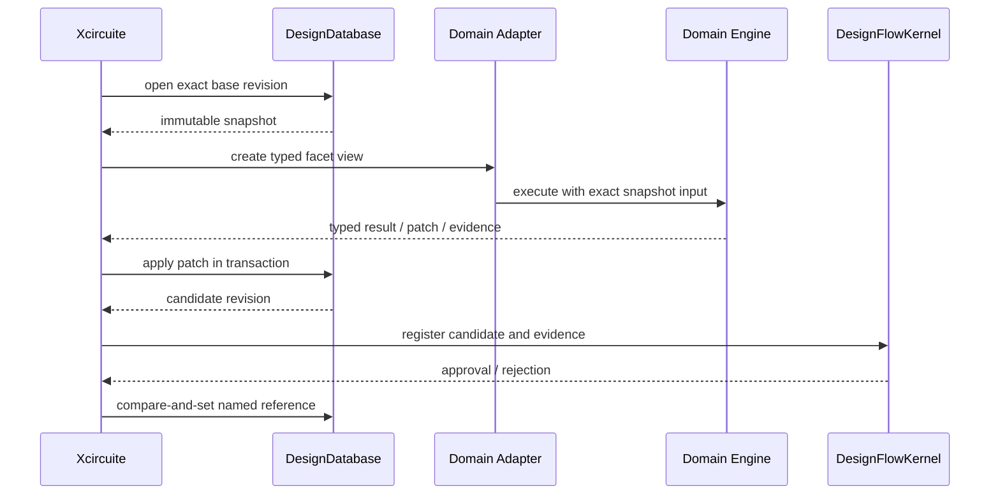

# DesignDatabase Design

Status: normative architecture with an executable safe reference backend. Sections 4-7, the in-memory forms of
the required indexes, candidate publication, full-image WAL recovery, and in-process negotiation are implemented.
Sections describing pages, immutable storage segments, zero-copy batches, remote transport, compaction, schema
generation, OpenDB binary bindings, and the external client remain target architecture rather than current behavior.
The neutral OpenDB object/property/relation adapter is implemented in the sibling `EDAInteroperability` package.

## 1. Purpose

`DesignDatabase` owns the canonical working state used while a design is edited and analyzed. Every observable
state is an immutable revision. Mutation occurs only through an explicit transaction that produces a candidate
revision. Standard artifacts remain authoritative at interchange, independent verification, and release
boundaries.

```mermaid
flowchart LR
  StandardIn["SPICE / LEF / DEF / OASIS / GDSII / SPEF"] --> Adapter["Domain Import Adapter"]
  Adapter --> Transaction["Design Transaction"]
  Transaction --> Candidate["Candidate Revision"]
  Candidate --> Engines["Domain Engines"]
  Engines --> Evidence["Diagnostics / Evidence / Typed Patch"]
  Evidence --> Review["DesignFlowKernel / Human Review"]
  Review --> Head["Promoted Named Reference"]
  Head --> StandardOut["Deterministic Standard Export"]
```



## 2. Ownership Boundary

| Concern | Owner |
|---|---|
| Shared IDs, schema / capability values, artifact / provenance values | `CircuiteFoundation` |
| Snapshot, transaction, revision DAG, query and storage | `DesignDatabase` |
| Logical semantics | `LogicDesign` |
| Technology semantics | `PDKKit` |
| Geometry and layout semantics | `semiconductor-layout` and physical model packages |
| Parasitic semantics | `PEXEngine` |
| Timing semantics | `TimingEngine` |
| OpenDB object conversion | `EDAInteroperability/OpenDBInteroperability` |
| OpenROAD artifact/process compatibility | `EDAInteroperability/OpenROADInteroperability` |
| Native placement / routing / CTS semantics | `PhysicalDesignEngine` |
| Approval and resume | `DesignFlowKernel` |
| Project and run composition | `Xcircuite` |

`DesignDatabase` does not import a domain package. It stores registered facet schemas and calls adapter-provided
validation / projection through Core protocols. It never interprets a cell, net, layer, waveguide, timing path, or
DRC violation by name.

## 3. Package Structure

```text
DesignDatabase/
├── Sources/
│   ├── DesignDatabaseCore/
│   ├── DesignDatabaseNative/
│   ├── DesignDatabasePersistence/
│   ├── DesignDatabaseService/
│   ├── DesignDatabaseSchemaCompiler/
│   ├── DesignDatabaseCLI/
│   └── DesignDatabaseTesting/
├── Tests/
│   ├── DesignDatabaseCoreTests/
│   ├── DesignDatabaseNativeTests/
│   ├── DesignDatabasePersistenceTests/
│   ├── DesignDatabaseServiceTests/
│   └── DesignDatabasePerformanceTests/
└── Benchmarks/
```

The OpenDB adapter is a separate package so Core, Native, WASM, and Embedded consumers never acquire a C++ or
OpenROAD dependency transitively. Its implemented pure mapping does not link either external project.

## 4. Database Object Model

A database contains immutable metadata and a DAG of immutable revisions.

```text
DesignDatabase
├── databaseID
├── creation schema set
├── capability set
├── named references
│   ├── main
│   ├── candidate/<run-id>
│   └── checkpoint/<name>
└── revisions
    └── DesignRevisionManifest
        ├── revisionID
        ├── parents
        ├── stateDigest
        ├── facet roots
        ├── index roots
        ├── changeSetDigest
        └── provenance references
```

`DesignRevisionID` is identity. `stateDigest` verifies canonical state bytes. They are deliberately separate.
Two revisions may contain identical state while retaining different lineage and identity.

### Entity identity

- `DesignEntityID` is unique and never reused within one `DesignDatabaseID`.
- deletion creates a tombstone in change history; it does not free the ID for another entity.
- exact resolution requires `DesignEntityReference` including revision and facet.
- hot-path access uses a revision-scoped compact `EntityHandle<T>` that is not persistent or `Codable`.
- OpenDB OIDs and other external identifiers use a scoped mapping table and never become native entity IDs.

## 5. Facet Architecture

Each domain adapter registers a facet descriptor before the first revision that uses it.



| Facet | Semantic owner | Representative entities |
|---|---|---|
| Logical | `LogicDesign` | module, instance, net, pin, port |
| Technology | `PDKKit` | process, layer, via, site, library |
| Physical | layout / physical model | block, row, placement, shape, route, via |
| Parasitic | `PEXEngine` | network, node, R/C/L element, corner |
| Timing | `TimingEngine` | constraint binding, derived timing annotation |
| DFT | `DFTEngine` | scan chain, test point, BIST association |
| Photonic | future photonic package | waveguide, optical port, mode, wavelength model |
| Assembly | future 3D/package package | die, chiplet, bump, bond, interposer |

A facet schema declares fixed fields and relations. A free-form property bag is not the canonical representation.
Unknown external properties are retained in a namespaced extension table with an explicit schema / loss report.

Schema registration is immutable for a revision. Adding or upgrading a facet produces a new revision after
compatibility validation; it never mutates the meaning of an existing revision.

### Schema compiler

Facet schemas are checked-in machine-readable inputs. `DesignDatabaseSchemaCompiler` validates them and generates:

- stable facet, table, column, relation, and index IDs;
- typed Swift accessors and mutation bindings;
- storage and record-batch descriptors;
- canonical serializer / comparator metadata;
- service schema descriptors and cross-language fixtures;
- schema-diff reports used to admit or reject migrations.

Generated code contains mechanical access and encoding only. Domain validation and algorithms remain handwritten
in the owning adapter. Generated output is reproducible, checked in or retained as a build artifact, and verified
against its source schema digest. Editing generated storage declarations without changing the source schema is a
build failure.

## 6. Read Snapshot

`DesignReadSnapshot` is immutable and `Sendable`.

- opening a snapshot may perform I/O and is asynchronous;
- reading an already opened snapshot is synchronous;
- a snapshot pins revision and index roots;
- multiple tasks may read one snapshot concurrently;
- snapshot reads never observe a partially committed transaction;
- closing a database does not invalidate an outstanding snapshot lease until the lease is released;
- a query result is always associated with the exact source revision.

Small control-plane results may be copied. High-volume results use a closure-scoped borrowed view or an owned
record batch. Unsafe pointers are not exposed by public API.

## 7. Transaction

`withTransaction(from:options:_:)` is asynchronous at its outer boundary and invokes a synchronous task-owned
mutation closure.



Transaction invariants:

- one explicit immutable base revision;
- one owner task; transaction values are not `Sendable`;
- read-your-writes semantics;
- no nested transaction;
- no `await`, external callback, or I/O inside a mutation closure;
- every relation target is validated before commit;
- entity creation, update, relation change, and deletion are recorded in one deterministic change set;
- cancellation or thrown errors publish no revision;
- a committed transaction produces a candidate revision but does not grant approval;
- named-reference promotion is a separate atomic compare-and-set operation.

Two transactions may commit independent candidate revisions from the same base. The current backend does not
merge candidates. The planned merge contract will accept only mechanically disjoint field / relation changes;
semantic conflicts remain the responsibility of the owning domain adapter or flow policy.

## 8. Target Storage Architecture

The current `DesignDatabaseNative` implementation is deliberately a safe value-semantic reference backend. It
stores revision-scoped dictionaries and builds immutable name, hierarchy, connectivity, spatial, cross-facet,
change, and dependency indexes when a snapshot is opened. Snapshots are cached by exact revision. It does not yet
claim paged-column, memory-mapped, zero-copy, or OpenDB-comparable performance.

The production storage target is a paged column store, not a tree of per-object Swift classes. This layout is not
implemented by the current dictionary-backed reference backend.

```text
Revision Root
├── Entity Directory
│   └── entityID -> facet / table / slot / generation / lifecycle
├── Facet Table Roots
│   ├── scalar columns
│   ├── interned string columns
│   ├── variable-length arena references
│   └── relation columns
├── Index Roots
└── Extension Roots
```

### Column and page rules

- fixed-width fields use contiguous typed columns;
- names and repeated strings use a revision-aware intern table;
- variable payloads use immutable segment ranges, not one allocation per entity;
- mutations copy only touched pages or variable segments;
- page size is chosen from benchmark evidence and is not part of the public API;
- page headers contain schema ID, column ID, element count, bounds, and checksum;
- offsets, counts, alignment, and integer overflow are validated before access;
- page bodies never store process pointers;
- memory owner and exactly-once deallocation are internal and testable.

The safe reference implementation uses ordinary Swift values. Any unsafe optimized implementation must be
differentially equivalent, have scoped borrows, and pass sanitizer / lifetime / overflow tests.

## 9. Required Indexes

| Index | Required behavior |
|---|---|
| Entity | constant-time entity ID resolution |
| Facet | entity enumeration by registered facet and kind |
| Name | exact name and optional normalized-name lookup |
| Hierarchy | parent / child and occurrence traversal |
| Connectivity | net / pin adjacency, driver / load, connected component |
| Spatial | region query by cell / layer / geometry class |
| Cross-facet | logical / physical / parasitic / timing identity mapping |
| Change | entity / field / relation changes between revisions |
| Dependency | derived facet validity and invalidation source tracking |

Each query declares ordering. Unordered query results must not be persisted or hashed. Pagination cursors include
revision and query-plan identity so they cannot be resumed against a different state.

The query planner returns structured explain evidence containing selected indexes, estimated scan scope, ordering,
temporary allocation budget, and whether a full scan was admitted. Agent and developer clients can inspect this
without parsing logs.

Spatial and connectivity indexes are first-class revision data. Tools are not required to rebuild private copies
for ordinary region or adjacency traversal. Specialized temporary algorithm indexes remain engine-owned.

## 10. Persistence

The current file backend persists a canonical full database image through `pending.wal` and
`database.manifest`. It holds both an in-process synchronized ownership registry and a process file lock, fsyncs
WAL/manifest/directory publication boundaries, validates the WAL payload digest, and revalidates revision DAG,
schema digests, state digests, change sets, entity schemas, references, and allocator state when opening. The
immutable-segment layout below is the next backend, not the current on-disk format.

```text
<database-root>/
├── database.manifest
├── refs/
│   └── <name>.ref
├── revisions/
│   └── <revision-id>.manifest
├── segments/
│   └── <content-digest>.segment
├── wal/
│   └── <transaction-id>.wal
└── locks/
```

- segments and revision manifests are immutable;
- WAL records are checksummed and length-bounded;
- a revision is visible only after every referenced segment is durable and its manifest is atomically published;
- recovery either completes a valid publication or removes an unpublished transaction record;
- corruption is a typed failure and never yields a partial successful snapshot;
- compaction rewrites physical storage but preserves database, revision, entity identity and state digest;
- `.xcircuite` stores a database locator and revision references, not page or WAL files.

SQLite may be used by an optional metadata catalog implementation. It is not the canonical entity / relation /
spatial hot-path store.

## 11. Concurrency

| State | Isolation |
|---|---|
| open / close, commit ordering, ref update, recovery | coordinator actor |
| immutable read snapshot | lock-free immutable owner |
| task-local transaction builder | single owner, non-`Sendable` |
| short page-cache bookkeeping | `Mutex<State>` |
| persistence I/O | actor ordered; outside `Mutex` critical section |
| service session lifecycle | actor |

Native, WASM, and Embedded share the same logical isolation contract. `hasFeature(Embedded)` must not replace a
`Mutex<State>` with raw mutable state or weaken `Sendable` / owner / lease contracts.

## 12. External Service

The native API and service API share identity, revision, schema, capability, error, and query semantics.



Control-plane messages carry Foundation values. Large data uses versioned binary record batches with explicit
endianness, field widths, offsets, null representation, bounds, and checksums. Local clients may use memory-mapped
immutable segments; remote clients use bounded streaming with backpressure.

Every remote operation has a deadline and cancellation path. Snapshot and transaction leases expire explicitly.
Change streams expose revision cursors and provide `shutdown()` that finishes their continuation.

## 13. OpenDB Compatibility

OpenDB compatibility is optional and isolated.

| Compatibility level | Design |
|---|---|
| Artifact | import / export LEF, DEF, and OpenDB-produced artifacts |
| Identity | map scoped OpenDB object type + OID + source DB digest to `ExternalObjectReference` |
| Object semantics | map `dbTech`, `dbLib`, `dbChip`, and `dbBlock` to registered facets |
| API | provide an OpenDB-style external client facade over exact DesignDatabase revisions |
| Behavior | run corpus differential tests and return structured loss reports |
| FFI | optional later optimization for qualified operations only |

OpenDB is based on LEF / DEF, exposes multiple database instances, and preserves 32-bit OIDs across save / restore.
Those properties are compatibility inputs, not Native storage constraints. OpenDB does not provide a general
region query and tools may build their own structures; DesignDatabase keeps spatial and connectivity indexes in
the canonical revision.

An OpenDB adapter never mutates a canonical revision directly. It creates a transaction patch, records source
identity and loss information, validates it, and produces a candidate revision.

OpenROAD algorithm adapters live in the owning Engine. Backend selection is explicit: `native`, `openROAD`, or
`correlation`. A native failure never silently falls back to OpenROAD.

OpenDB compatibility inputs are based on the official OpenDB object / OID / save-restore contracts. OpenDB's
schema generator is an interoperability reference, not a source dependency. DesignDatabase uses its own facet
schema compiler so photonic, 3D, multi-physics, revision, service, and integrated-index contracts are not constrained
by LEF / DEF object layout.

## 14. Standard Formats

| Boundary | Authority |
|---|---|
| active edit and analysis | immutable DesignDatabase revision |
| import / export | owning standard parser / serializer package |
| independent verification | digest-verified standard artifact and raw tool evidence |
| tapeout / release | standard artifacts accepted by release policy |
| run history | `.xcircuite` ledger referencing exact revisions and artifacts |

Importers create transactions. Exporters read an exact snapshot. Every export records source revision, schema set,
producer, configuration, artifact digest, and byte count. Round-trip loss is explicit.

## 15. Performance Contract

Performance claims require a named workload and measurement. Required benchmark dimensions include:

- entity lookup latency;
- hierarchy traversal throughput;
- connectivity traversal throughput;
- layer / region spatial query latency;
- transaction mutation and commit throughput;
- snapshot open latency;
- revision diff latency;
- persistence save / restore throughput;
- resident memory per entity / relation / shape;
- allocations and copied bytes per operation;
- service record-batch throughput and backpressure behavior;
- corresponding OpenDB workload where semantic parity exists.

No fixed page size, tree type, unsafe representation, or compression algorithm is accepted without benchmark and
differential correctness evidence.

## 16. Failure Contract

Errors are typed by boundary: identity, schema, capability, snapshot, query, transaction, conflict, validation,
persistence, corruption, resource, service, and external compatibility.

- unavailable entities do not become empty records;
- unknown facets do not become generic property bags;
- corrupted pages do not become zeroed pages;
- unsupported queries do not become full scans unless the caller explicitly permits a scan plan;
- failed native operations do not silently invoke an external backend;
- interrupted commits do not publish revisions;
- compatibility loss never reports lossless success.

## 17. Integration Sequence



Database atomicity, flow approval, and engine correctness remain separate decisions.

## 18. References

- [OpenDB official documentation](https://openroad.readthedocs.io/en/latest/main/src/odb/README.html)
- [OpenDB code generator documentation](https://openroad.readthedocs.io/en/latest/main/src/odb/src/codeGenerator/README.html)
- [OpenROAD developer guide](https://openroad.readthedocs.io/en/latest/contrib/DeveloperGuide.html)
