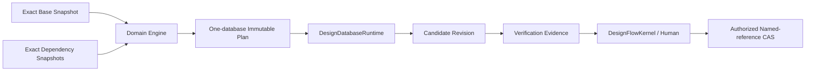
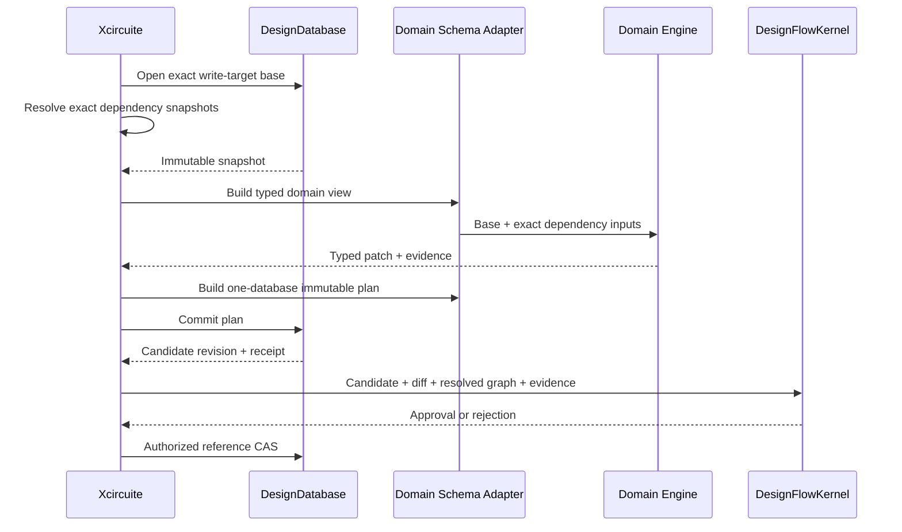

# DesignDatabase Design

Status: normative target design with executable Native reference and partial framework Runtime.

The current package implements immutable reference revisions, closure-based reference
transactions, exact in-memory snapshots, nine in-memory projection families,
revalidated authorization grants, subject-scoped operation identity, and a Native
operation-identified retention lifecycle with canonical request/outcome digests and
exact-image reconciliation, full-image WAL recovery, and an in-process service. The
framework-backed production Runtime now provides immutable plan admission, atomic
candidate/reference/retention operations, canonical facet-root manifests, and exact
closure-scoped Runtime reads. Persistent semantic projection pages, domain adapters,
exact workspace dependency resolution, production-qualified remote service, and retained circuit-scale
performance evidence are not implemented. Xcircuite's secret-free schema-v4 mount
catalog and first managed-local provider/session activation are implemented separately.

The normative companion documents are:

- `DATABASE_FRAMEWORK_RUNTIME_ARCHITECTURE.md`: fixed framework integration and
  persistent Runtime;
- `SCHEMA_ADAPTER_ARCHITECTURE.md`: domain schema, validation, and interoperability
  boundaries;
- `INTERFACES.md`: target public API contracts;
- `REQUIREMENTS.md`: implementation and evidence requirements;
- `../DESIGN_WORKSPACE_ARCHITECTURE.md`: project/database granularity, mounts,
  dependency graph, ECO, and multi-database release.

## 1. Purpose

DesignDatabase is the canonical working-state store for one independently versioned,
approved, released, retained, and permissioned design unit.

Every observable design state is an immutable exact revision. A mutation is an
immutable plan bound to one database, one base revision, one schema root, and one direct
dependency root. A successful commit produces a candidate revision; it does not approve
or release that candidate.



Standard artifacts remain authoritative at interchange, independent verification, and
release boundaries.

## 2. Ownership Boundary

| Concern | Owner |
|---|---|
| Shared exact identities, content identity, evidence, diagnostics, and provenance | `CircuiteFoundation` |
| Generic values and model/query/schema declarations | `database-types` and `database-kit` |
| Generic transactions, model persistence, query/index execution, migrations, and service execution | Fixed public API of `database-framework` |
| Physical backend persistence | `storage-kit`, reached only through the framework |
| Design revision DAG, exact snapshots, direct dependency lock, semantic pages, and named-reference CAS | `DesignDatabase` |
| Database-independent domain meaning and pure validation | Domain package |
| Database representation, cross-facet constraints, and overlay validation adaptation | Domain database schema target |
| Project mounts, provider profiles, credentials, artifact availability, and resolved dependency graph | `Xcircuite` |
| Approval, waiver, and resume | `DesignFlowKernel` |
| Multi-database release authorization and tapeout bundle | `ReleaseEngine` |
| OpenDB/OpenROAD/XLS mapping and loss evidence | `EDAInteroperability` |

DesignDatabase does not import a domain package in Core or Runtime. Domain integrations
are separate host-only packages. It does not modify `database-framework`, call
`storage-kit` directly, or implement a second generic database runtime.

## 3. Database Unit

A database is not a UI project and not one domain facet.

Use one database for state that must:

- commit and validate atomically;
- share one owner and permission boundary;
- be reviewed and released together;
- retain one coherent identity and revision history.

Use separate databases for independently released blocks, macros, libraries, PDKs,
dies, chiplets, or package assemblies. Logical, physical, parasitic, timing, and DFT
facets belonging to one block remain together.

Xcircuite may mount multiple databases, but each mutating command selects exactly one
database and exact base revision.

## 4. Object Model

```text
DesignDatabase
├── database catalog and feature-capability profile
├── exact schema bundles
├── immutable revisions
│   └── DesignRevisionManifest
│       ├── parents
│       ├── state digest
│       ├── schema root
│       ├── direct dependency root
│       ├── facet roots
│       ├── projection semantic descriptors/digests
│       ├── direct change root
│       └── provenance
├── physical materialization bindings/generations
├── revision/materialization lifecycle and collection intents
├── named references
├── operation receipts
└── active/released retention claim records and operation outcomes
```

`DesignRevisionID` is lineage identity. `stateDigest` verifies canonical content. Two
revisions may have identical content while preserving distinct lineage.

## 5. Identity

- `DesignDatabaseID` identifies one database across provider relocation.
- `DesignEntityID` and relation-occurrence ID are database-scoped, nonzero, and never
  reused.
- `DesignRevisionReference` always carries database and revision identity.
- `DesignEntityReference` always carries exact revision, facet, kind, and entity.
- Cross-database entity bindings explicitly name a dependency-lock entry and exact
  `DesignEntityReference`; they never become intra-database entity IDs.
- Hot-path handles are snapshot-local, non-persistent, and non-`Codable`.
- External IDs such as OpenDB OIDs remain scoped external identities with explicit
  mapping evidence.

## 6. Direct Dependency Lock

Each revision stores an immutable direct dependency root. It contains:

- stable dependency ID and semantic role;
- exact design revision or location-independent artifact content identity;
- required schema and feature-capability contracts;
- exact interface/abstract-view digest;
- retention evidence.

It contains no provider profile, path, URL, endpoint, credential, cache location, or
mutable named selector. The root is included in the revision state digest.

DesignDatabase validates the lock structure and plan binding. Xcircuite resolves the
transitive graph and availability. ReleaseEngine verifies the complete resolved graph
for release. No layer silently resolves `latest`.

## 7. Facet Model

| Facet | Semantic owner | Representative state |
|---|---|---|
| Logical | `LogicDesign` | module, instance, net, port, pin |
| Technology | `PDKKit` | process, layer, via, site, library |
| Physical | layout and physical packages | block, placement, shape, route, via |
| Parasitic | `PEXEngine` | network, node, R/C/L, corner |
| Timing | `TimingEngine` | constraint binding and derived annotation |
| DFT | `DFTEngine` | scan chain, test point, BIST association |
| Photonic | future photonic package | waveguide, optical port, mode, wavelength model |
| Assembly | future 3D/package package | die, bump, bond, interposer |

Each domain integration provides:

- exact framework model/schema contribution;
- stable facet bindings;
- typed read projection;
- import/export plan builders;
- database representation and cross-facet constraints;
- bounded overlay adaptation to the domain's pure validator;
- dependency/invalidation rules;
- facet migration policy.

The Runtime adapter contributes these declarations to one exact framework registration
bundle. It contains no domain algorithm or backend selection.

## 8. Validation

| Validation class | Owner |
|---|---|
| Persisted field, required/default/reference, relationship, uniqueness, index, and physical migration invariants | `database-framework` |
| Database/revision/schema/dependency/plan binding and candidate publication | `DesignDatabaseRuntime` |
| Circuit-domain meaning independent of persistence | Domain package pure validator |
| Database representation and cross-facet proposed-overlay adaptation | Domain schema target |
| DRC/LVS/STA/PEX/formal/signoff | Owning Engine outside commit |

Validators are deterministic and side-effect-free. They may use only the supplied exact
base/proposed view and explicit budgets. External tools, clock, randomness, event
emission, and hidden global state are not commit validators.

## 9. Snapshot

`DesignReadSnapshot` is an immutable, reference-semantic, `Sendable` lease owner.
`DesignReadSnapshotReading` is its non-owning read contract, and
`DesignReadSnapshotView` is the concrete value lent across compiler/validator
boundaries that must not receive close authority:

- open is asynchronous;
- entity/query/change access may perform bounded asynchronous I/O;
- all reads are bound to one exact revision;
- independent reads are not serialized through one DesignDatabase actor;
- multiple snapshots may share immutable decoded pages;
- close is explicit, idempotent, and its cleanup result is observable;
- a retained read view never extends the lease and fails typed after its owner closes;
- a database handle cannot shut down while child snapshots or operations remain active;
- high-volume results are bounded owned pages or closure-scoped borrowed views.

The current synchronous Native snapshot is a reference oracle, not the production API.

## 10. Plan-First Commit

The target public commit accepts one immutable `DesignMutationPlan`.

The plan binds:

- one database ID;
- one exact base revision;
- one exact schema root;
- one exact direct dependency root;
- one local operation ID and request digest, qualified at admission by the exact database
  and stable authenticated authorization subject scope;
- bounded semantic operations/chunks;
- explicit provenance and resource budgets.

Preparation:

1. verifies the complete binding;
2. reads the exact base and proposed overlay under bounds;
3. assigns permanent entity/occurrence identities without reuse;
4. runs generic and domain validation at their owning layers;
5. creates immutable facet/projection/change pages;
6. stores fixed pages under a staging root;
7. computes the candidate manifest and canonical digests.

One final framework transaction publishes the complete revision manifest and operation
receipt or publishes no candidate. Framework retry never calls the plan builder,
validator, external tool, or event sink.

Commit and named-reference promotion are separate. An Agent can create a candidate but
cannot approve it by using the commit API.

The current `withTransaction` closure API remains Native-reference behavior until the
target API replaces it.

## 11. Semantic Projections

DesignDatabase owns nine revision-bound projection families:

| Projection | Contract |
|---|---|
| Entity | Exact stable-ID lookup |
| Facet | Enumeration by exact facet and entity kind |
| Name | Exact/interned name and hierarchy-path lookup |
| Hierarchy | Parent/child occurrence traversal |
| Connectivity | One-hop occurrence-preserving adjacency and driver/load lookup |
| Spatial | Conservative container/layer/bounds candidates |
| Cross-facet | Explicit logical/physical/parasitic/timing identity mapping |
| Direct change | Typed key/before/after delta from target manifest state base |
| Dependency | Derived-state source and invalidation lookup |

Each revision stores boundary-independent semantic projection descriptors: family,
semantic version, ordered entry count/key bounds, and a canonical sequence digest that
does not depend on page size, fanout, physical codec, compression, or packing.

Runtime separately binds each descriptor to one immutable physical materialization
generation/root made of bounded content-addressed application node models stored through
`database-framework`. A verified repack may CAS-publish a new physical generation for the
same semantic digest without changing the revision or state digest. A snapshot pins one
generation. These nodes are not new framework index types.

Every canonical hierarchy, connectivity, cross-facet, and dependency edge has a stable
relation-occurrence identity. Ordered or repeated edges are not represented by a set.

Spatial entries have explicit `unlayered` or `layer` scope and stable nonzero IDs.
Database pages return conservative bounds candidates; exact geometry is domain-owned.

## 12. Query and Paging

Circuit-scale paging is keyset-based over one exact semantic descriptor and one pinned
physical materialization. A continuation
binds:

- database/revision/schema/projection semantic identity;
- materialization generation, physical codec/profile, and root;
- normalized semantic query;
- canonical order;
- last consumed key;
- page and whole-query budgets;
- DesignDatabase-observable node-fetch, encoded-read-byte, decoded-retained-byte,
  output-byte, candidate, work, and result accounting;
- completion reason.

It does not use offset-only resume or fingerprint all preceding results. Current generic
framework cursors and materialized index results are excluded from the authoritative
circuit-scale path by contract and remain limited to explicitly bounded control-plane
uses. Performance measurement cannot convert their offset/all-row semantics into a
semantic keyset continuation.

Unsupported or unindexed high-volume queries fail typed. They do not silently run a
full scan.

Physical projection trees are immutable copy-on-write balanced B+trees. All leaves share
one depth; canonical key ranges are ordered, non-overlapping, and covering; non-root
nodes satisfy declared minimum/maximum occupancy; split/merge restores occupancy before
publication; and updates path-copy only affected root-to-leaf paths. Publication verifies
height, occupancy, range coverage, node byte limits, entry count, and semantic digest.
The checked profile therefore bounds lookup by `O(log N)` node fetches and paging by
`O(log N + visited page nodes)`.

## 13. Persistence and Recovery

Production state is persisted only through framework public model and transaction APIs.
DesignDatabase has no raw `storage-kit` bootstrap, key codec, page allocator, or WAL.

- creation atomically inserts catalog, genesis revision, empty roots, creation receipt,
  and `main`;
- open lets framework perform physical migration, then validates the exact
  DesignDatabase catalog, registration, schema, feature capability, and roots;
- each staging transaction atomically inserts bounded immutable nodes and advances an
  authenticated build-intent progress root;
- candidate semantic descriptors and initial physical bindings remain invisible until
  one manifest transaction publishes them with the receipt and terminalizes the intent;
- subject-scoped operation receipts make idempotent results and typed failures
  recoverable without cross-subject ID collision or disclosure;
- unknown outcomes are reconciled from persisted operation state;
- named references use exact revision plus generation CAS;
- retention activation and exact revision+generation CAS release are operation-identified,
  idempotent, and unknown-reconcilable; released claim IDs remain tombstoned and cannot
  be reused;
- semantic/physical GC uses a persisted reachability generation, epoch-bound root set,
  per-delete generation recheck, and candidate-set-scoped Runtime
  semantic-revision/materialization deletion admissions. Before its first node delete,
  an atomic framework transaction persists the collection intent and changes the
  revision or retired-generation lifecycle to deleting; a changed
  publication/reference/retention/intent/binding restarts mark, while a targeted lease
  race invalidates only its bounded batch and unrelated lease churn does not stop GC;
- `storage-kit` owns physical durability and compaction.

Opening a snapshot does not write a persistent pin. Local/direct profiles permit one
maintenance authority; shared profiles use one qualified service authority. Retired
semantic revisions and physical generations remain protected by pending/active Runtime
snapshot leases. GC deletion admission rejects new leases for an exact candidate until
its persisted collection intent reaches a terminal collected tombstone or aborts before
any node deletion. Runtime reconstructs every nonterminal admission before accepting
opens after restart, so no snapshot can observe a partially deleted tree. Exact semantic
revision identity remains unchanged and is never reused.

The current full-image WAL remains a reference backend only.

## 14. Concurrency

| State | Isolation |
|---|---|
| Framework container and persisted transactions | Framework lifecycle and transaction contract |
| DesignDatabase handle/session | Explicit owner with child operation/snapshot leases |
| Snapshot | Immutable concurrent owner |
| Finished mutation plan | Immutable `Sendable` value/owner |
| Preparation | Task-owned bounded workers over exact immutable inputs |
| Decoded-page cache | Sharded `Mutex<State>`; I/O/decode outside lock |
| Snapshot/GC lease coordinator | One maintenance-authority actor; ordered pending/active/deletion-admission transitions, with framework I/O outside isolation |
| Workspace mount/session | `Xcircuite` actor because I/O and ordered lifecycle are involved |

Native, WASM, and Embedded must retain the same shared-state isolation contract. Target
capability differences are explicit; `hasFeature(Embedded)` never removes synchronization.

Serialization is an explicit package capability rather than a portable Core invariant.
The default `FoundationSerialization` trait enables `Codable` contracts and the
`CircuiteFoundationFoundation` bridge required by host persistence, Runtime payloads,
and service wire messages. Building `DesignDatabaseCore` with
`--disable-default-traits` removes that dependency and the codec declarations while
preserving the same value validation, ordering, ownership, and isolation behavior.
Portable consumers must not infer serialization support from the presence of a Core
value; host boundaries select the trait deliberately. Unsupported product/profile
combinations fail at build or through a typed capability result and never fall back to
another backend.

## 15. Workspace and Release Boundary

DesignDatabase opens and mutates one database. Xcircuite composes multiple mounts and
exact snapshots.

There is no cross-database transaction. Multi-database ECO and SoC/chiplet release use:

- independently verified candidates;
- explicit dependency updates in parent candidates;
- one immutable resolved dependency graph;
- one ReleaseEngine-owned multi-database bundle.

Within one database, deterministic disjoint-branch assessment remains read-only. A
separate validated merge-publication operation binds one exact one-parent validation
commit, re-assesses the same base and parents, authenticates that commit's persisted
claim/outcome inside the bounded publication transaction, and may publish a distinct
two-parent candidate revision. This operation does not update `main` or confer approval,
qualification, or release authority.

`.xcircuite` stores mount configuration, exact references, run/actions, approval, and
artifact availability. It does not store DesignDatabase pages, indexes, WAL, or recovery
state.

## 16. External Compatibility

DesignDatabase provides protocol-neutral exact revision, query, plan, and extension
contracts. EDAInteroperability owns:

- OpenDB OID and object mapping;
- `.odb`, LEF, and DEF conversion;
- OpenROAD process/artifact adapters;
- XLS mapping;
- compatibility-only metadata schema;
- loss reports and differential evidence.

Canonical domain objects are written through their domain schema adapters. Optional
compatibility metadata uses an explicit compatibility schema and a mechanical
registration adapter composed by Xcircuite.

External tools never mutate a canonical revision directly. Native failure does not
silently select an external backend.

## 17. Standard Formats

| Boundary | Authority |
|---|---|
| Active working state | Exact DesignDatabase revision |
| Cross-database dependency | Exact revision/content dependency lock |
| Import/export | Owning standard parser/serializer |
| Independent verification | Digest-verified standard artifact and raw evidence |
| Release/tapeout | Release bundle plus standard artifacts and signoff evidence |
| Human/Agent history | `.xcircuite` ledger with exact references |

Every import produces a base-bound candidate plan. Every export reads one exact snapshot
and records revision, schema, dependency graph, producer, configuration, digest, and
byte count.

## 18. Performance Contract

Measure before optimizing. Retained evidence must name:

- workload and dataset digest;
- entity/relation/shape counts;
- backend profile and schema/projection versions;
- hardware, build, and cache state;
- p50/p95/p99 latency and throughput;
- peak memory, allocations, copied bytes, and storage amplification;
- exact correctness digest against the Native oracle.

Full-process allocations and copied bytes are benchmark evidence. Continuations report
only DesignDatabase-observable node fetches and encoded/decoded/output byte counters;
they do not claim visibility into backend-internal copies.

Required paths include entity, hierarchy, connectivity, spatial candidate/refinement,
dependency update, plan preparation/commit, snapshot open/cache, direct change, and
service paging.

Unsafe or zero-copy work requires explicit owner/borrow lifetime, differential tests,
sanitizers, and measured improvement. A slow backend profile may be rejected or replaced
through Xcircuite composition; it does not justify patching the fixed framework.

## 19. Failure Contract

Errors are typed by identity, open, schema, capability, dependency, snapshot, query,
plan, validation, conflict, persistence, corruption, resource, authorization, service,
and compatibility boundary.

- missing state is not an empty record;
- missing dependency is not another revision;
- unsupported query is not an implicit full scan;
- commit disconnect is not guessed success/failure;
- failed native execution is not external fallback;
- compatibility loss is not lossless success;
- cross-database mutation is rejected before admission;
- release incompleteness is not an approved bundle.

## 20. Integration Sequence



Until this framework-backed path and at least one real domain vertical slice pass their
success, failure, recovery, and performance gates, DesignDatabase is not production
ready.
