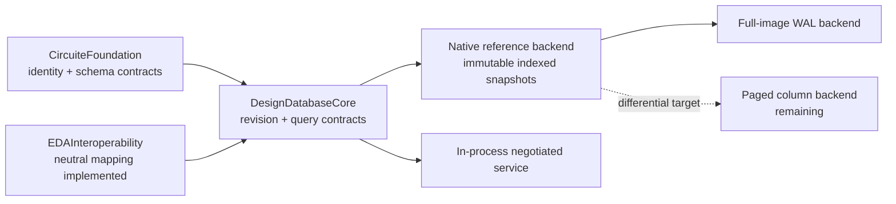

# DesignDatabase Goal Status

| Area | State | Evidence |
|---|---|---|
| Responsibility boundary | Implemented | Depends only on `CircuiteFoundation`; domain semantics and EDA algorithms are absent |
| Canonical identity | Implemented | Database/revision/entity/facet/kind references are scoped Foundation values |
| Revision lifecycle | Implemented | Exact immutable snapshots, candidate transactions, separate CAS promotion, ancestry-limited diffs |
| Query correctness | Implemented for reference backend | Nine index families, explicit ordering/limits, fail-closed plan admission, explain evidence |
| Schema uniqueness | Implemented for reference backend | Sparse composite unique constraints, deterministic typed conflicts, reopen corruption detection |
| Recovery correctness | Implemented for full-image backend | WAL checksum, fsync publication, lock ownership, semantic reopen validation |
| External access | Partial | Capability negotiation and leased in-process sessions exist; remote framing/streaming do not |
| High-performance storage | Not implemented | Current dictionaries and JSON images are the differential reference, not the production backend |
| OpenDB compatibility | Partial | Neutral object/property/relation export and preflighted transaction import with loss reports are tested in `EDAInteroperability`; C ABI, `.odb` artifacts, qualified corpus, and external client remain |
| Portability | Not verified | Native macOS is tested; WASM and Embedded compile/link/runtime evidence is absent |

