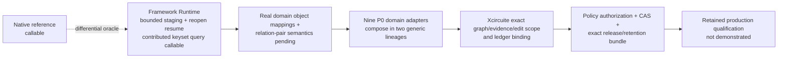

# DesignDatabase Goal Status

Updated: 2026-08-11

| Area | State | Evidence / missing work |
|---|---|---|
| Isolated package resolution | Pending commit ordering | The LSI sibling workspace builds; the remote CircuiteFoundation pin predates the new subject-scope type and must advance after the Foundation change is committed |
| Responsibility boundary | Enforced on the implemented production path | Core is domain-neutral; Runtime receives a host-owned container; domain integration, workspace, flow, release, and interoperability remain separate owners |
| Project/database separation | Persisted boundary and first host activation implemented | One DB is one independent version/release/permission unit; Xcircuite schema v4 stores a secret-free multi-mount catalog and its explicit workspace runtime opens managed-local provider sessions; exact dependency resolution and ledger binding remain |
| Canonical identity | Implemented in reference | Database/revision/entity/facet/kind exact values exist in CircuiteFoundation |
| Artifact identity/availability | Implemented in Foundation; consumer migration in progress | ArtifactReference is content-only and availability/access are separate; DesignDatabase and remaining workspace consumers still require full migration |
| Immutable revision lifecycle | Reference plus Runtime path-copy implemented | Native and Runtime expose exact snapshots, candidate-only commits, and separate reference CAS; Runtime publishes facet plus validated adapter-contributed projections, inherits unchanged roots, and updates existing families through immutable exact-base path-copy without changing `main` |
| Direct dependency lock | Exact replacement implemented; indexed projections pending | Runtime revision manifests persist the canonical direct lock plus dependency-root and semantic-graph digests, exact snapshots expose them, candidate admission rejects a stale binding, and a mutation plan may atomically publish one exact replacement. Indexed dependency-entry projections and retained migration/qualification remain |
| Fixed-framework Runtime | Bounded staged candidate, qualified abandonment, immutable projection mutation, and bounded collection sweep implemented | Exact pinned dependency, immutable contribution bundle, host container attachment, atomic create/open, exact-base validation before claim, digest-verified validated-input capsule persisted atomically with permanent ID reservation, deterministic post-claim materialization, exact physical-write directory, persisted commit-build intent, administrator-qualified exact pre-intent/active-staging abandonment, 64-write bounded staging and collection transactions, bounded multi-family publication, unchanged-root inheritance, exact-base path-copy, scoped operation claims, exact keyset query, closure-scoped model reads, named-reference CAS, retention lifecycle, semantic/physical root audits, rejected-staging reclamation, registered reclaimers, resumable deleted-prefix progress, and terminal collected receipts exist; policy receipt roots and the retained full crash/recovery matrix remain |
| Generic framework correctness | Fixed release consumed | `database-framework` 26.809.1 is pinned through the public `Database` product; registration uses canonical `SchemaManifest` fingerprint and complete compiled entity schema validation without framework modification or storage bypass |
| Persistent semantic projections | Generic Runtime plus first real domain vertical slice implemented | Runtime publishes boundary-independent semantic-v2 descriptors and content-addressed physical-codec-v2 balanced immutable B+trees. Exact updates validate `before`, path-copy only affected nodes, rebalance split/merge, collapse the root, persist subtree counts, and retain semantic identity across alternate packing. Relation insertion/update/target-move/delete requires complete outgoing/incoming pairs, and only insertion consumes a reserved ID. Public SQLite smoke covers update/split/merge/root-collapse/reopen; Logic public-API smoke covers stable object IDs, add/remove, paired hierarchy, and exact-before-state rejection. Remaining domain mappings and retained qualification remain |
| Query correctness | Generic Runtime vertical path implemented | Exact snapshot queries pin revision, semantic descriptor, binding generation, physical root, normalized query, and cumulative budget. Facet and contributed entity paging are keyset-based with explicit completion; retained Native differential evidence and family-specific semantics remain |
| Revision diff and disjoint merge | Facet-root diff, assessment, and validated publication implemented | Arbitrary exact-revision diff and deterministic branch assessment are separately budgeted. Two-parent publication re-assesses the candidate, authenticates its one-parent validation commit from the persisted claim/outcome in the same transaction, requires opposing and dependency-bound facet validation, preserves shared physical writes, leaves `main` unchanged, and records stale assessment or state mismatch as typed outcomes. Entity/relation-level merge semantics and retained crash/unknown-outcome qualification remain |
| Circuit-scale query performance | Source-bound cache copy-path evidence retained; production qualification incomplete | Persistent facet keyset pages and an attachment-owned lease-aware decoded-page cache exist. Direct behavior tests pass pinned eviction, close-with-live-view lifetime, concurrent borrow/close serialization, and cache-independent logical budgets. The retained entity-projection artifact proves identical correctness plus zero warm DB-read/decode/materialization increments and 121 avoided payload bytes. Full-process allocation, Native differential, repeated circuit-scale latency/throughput, and qualified backend evidence remain |
| Local SQLite profile | Not production-qualified | Reviewed current backend serializes async reads through one connection; DesignDatabase cannot claim concurrent persistent reads |
| Schema/validation boundary | Designed | Framework=generic, Runtime=binding/publication, domain=pure semantics, schema target=database/cross-facet adaptation |
| Domain adapters | Nine canonical P0 integrations compose into generic lineages; Logic object projection implemented | Every P0 adapter registers an exact physical-write reclaimer using the same storage type, partition, model ID, and identity reconstruction as staging. Logic emits stable object identity plus entity/name/paired-hierarchy changes while retaining canonical RTL/gate/power documents. Both generic sky130A database-bound lineages execute through planning, candidate receipt, verification, approval, promotion, release, and retention. PDK, standard-cell, circuit, layout, physical, parasitic, timing, and DFT remain document-level integrations; migration, retained per-domain round trips/reclamation, and the other eight object mappings remain |
| Recovery | Reference WAL plus Runtime validation/materialization/staging/collection resume and qualified abandonment implemented | Native uses monotonic persistence generations and exact current/proposed image equality for lost-response reconciliation. Runtime persists request-bound validated/prepared metadata, staging progress, collection identity directories, rejected-root bindings, claims, and deleted-prefix progress. Targeted fixtures executed exact pre-intent/active-staging abandonment, administrator-grant rejection, target receipt replay, and startup recovery audit; compiled fixtures additionally cover deterministic staging resume, authenticated collection recovery, exact physical deletion, rejected-root reclamation, terminal receipt replay, and missing-reclaimer rejection. The wider publication/collection crash and corruption matrix remains |
| Retention lifecycle | Native reference and framework Runtime implemented; restart qualification pending | Versioned binary request/outcome digests, subject-scoped replay, generation CAS, reachability generation, permanent tombstones, authorization revalidation, and unknown-result responses exist; persistent restart/corruption/concurrency qualification remains |
| Collection safety | Implementation connected; retained behavioral qualification pending | Exact snapshot leases and semantic/physical root audits precede atomic visible-to-deleting admission. Candidate/domain/projection writes are claimed by immutable identity, rejected staging roots transition through reclaiming to reclaimed, and bounded deletion persists exact prefix progress before lifecycle/root/reachability/receipt terminalization. Startup reconstructs nonterminal admission; collected lifecycle permanently rejects exact opens. Success, rejected-root, and missing-reclaimer contracts compile, but first/middle/final crash, unknown-outcome, claim/model tamper, concurrent root publication, and starvation scenarios have not been executed and retained |
| External service | Typed remote contract, standard-I/O process transport, and DB-bound Xcircuite host execute; production qualification pending | Public service/session protocols separate the contract from in-process actors and the remote proxy. SHA-256-bound versioned envelopes and binary query pages cross a subject-scoped dispatcher. Direct behavior tests pass exact snapshot ownership, remote query/commit/reconnect reconciliation, scope-misrouting and shutdown-authorization rejection, timeout teardown, and standard-I/O host shutdown. A child `xcircuite-flow` process now opens a real managed-local database, negotiates, resolves an exact revision, opens and queries a snapshot, shuts down in owner order, and permits an exact reopen. Production credential mapping and the wider disconnect/cancellation/close-failure matrix remain |
| Xcircuite integration | Exact managed-local workspace and one-target lineage implemented | Xcircuite schema v4 stores typed secret-free mounts; immutable provider registration, managed-local public-framework composition, exact dependency graph plus separate resolution evidence, one-target edit scope, candidate receipt/diff, ledger binding, and reverse shutdown execute in both generic sky130A lineages. Provider qualification and lifecycle stress evidence remain |
| Flow/release integration | Exact policy and release lineage implemented | DesignFlowKernel authorizes but does not execute promotion; Xcircuite verifies evidence and grant, executes reference CAS, and retains the outcome. ReleaseEngine consumes exact revision/content/approval/qualification/retention bindings in the generic acceptance lineages. Production-qualified external-tool evidence remains unavailable |
| OpenDB compatibility | Partial outside package | Neutral mapping exists; compatibility schema registration, C ABI, `.odb`, corpus, and client absent |
| Portability | Foundation Core and DesignDatabaseCore runtime verified; remaining product matrix pending | The exact Foundation Core and serialization-disabled DesignDatabaseCore probes compile, link, and run with byte-identical output on Native, pinned WASI, and pinned Embedded WASM. DesignDatabaseCore uses an explicit default `FoundationSerialization` trait for host wire contracts and removes that dependency and its codec methods in the portable profile. Native/Persistence/Runtime/Service capability, isolation, link, and runtime qualification remains |
| Production readiness | No | The generic P0 lineage and DB-bound process service are behaviorally connected, and a source-bound cache artifact is retained. The full recovery/race matrix, object-level domain mappings, retained process-service lifecycle qualification, circuit-scale performance evidence, remaining DesignDatabase product matrix, and production tool/PDK qualification remain |

No `database-framework` change is a DesignDatabase task. If a backend or public
capability cannot satisfy a required contract, that profile is typed unsupported or
fails qualification; DesignDatabase does not bypass or patch the stack.
