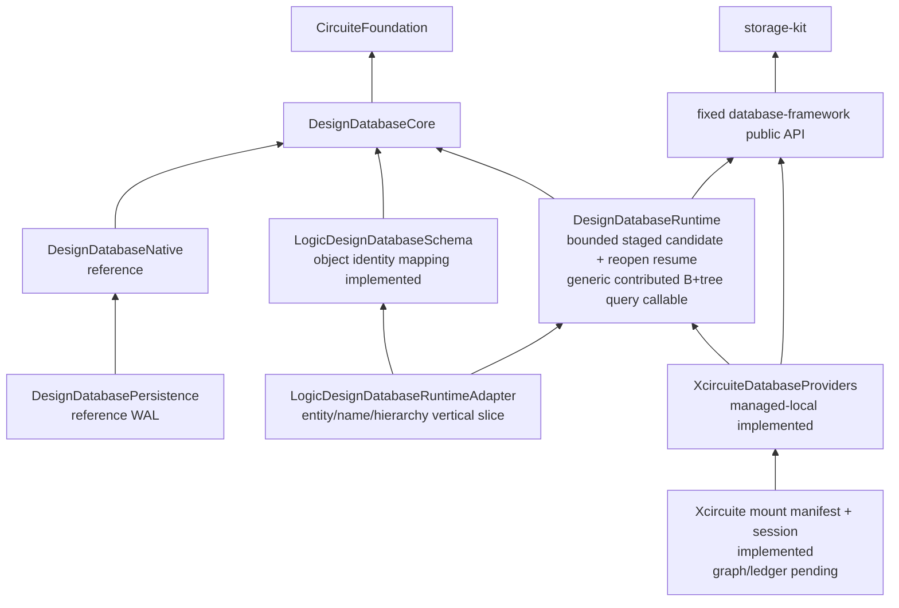

# DesignDatabase

Status: executable Native reference backend / framework Runtime bootstrap in progress.

DesignDatabase stores the canonical working state of one independently versioned,
released, retained, and permissioned semiconductor design unit. It is not an Xcircuite
project and it is not one database per domain facet.

The current package implements:

- immutable Native revisions and exact snapshots;
- candidate-producing reference transactions;
- nine in-memory projection families;
- deterministic coarse changes and named-reference CAS;
- separate feature capabilities and revalidated authorization grants;
- subject-scoped operation identity;
- operation-identified Native retain/release/status with request-digest replay,
  generation CAS, permanent release tombstones, canonical request/outcome digests,
  exact-image lost-response reconciliation, and corruption validation;
- full-image WAL/recovery for the reference backend;
- an exact-handle in-process service with negotiated leased sessions, bounded in-flight
  work, session-owned exact snapshots, shutdown draining, and explicit
  commit/reference/retention outcome reconciliation;
- a versioned binary semantic-query page codec with bounded frame, metadata, row,
  canonical-key, and row-value decoding plus typed malformed-frame failures;
- a versioned digest-bound service envelope, remote typed proxy, subject-scoped
  dispatcher, length-prefixed standard-I/O host, and child-process transport with
  timeout-triggered connection teardown and bounded graceful close;
- an exact fixed-`database-framework` dependency and `DesignDatabaseRuntime` product;
- immutable runtime contribution composition with separate physical registration and
  exact semantic schema-bundle identities;
- host-owned `DBContainer` attachment with schema fingerprint fail-closed validation;
- atomic framework-backed catalog/genesis/`main`/exact schema-bundle/creation-receipt
  publication, idempotent replay/status, and full-member catalog inspection.
- framework-backed exact named-reference CAS with scoped operation claims, replay/status,
  generation tombstones, and per-call authorization revalidation;
- framework-backed retention activation/release/status with exact revision and claim
  generation CAS, reachability generation, permanent tombstones, and unknown outcomes.
- framework-backed immutable candidate admission with canonical plan/request digests,
  registered mutation adapters, exact-base validation before operation claim, an opaque
  validated-input directory persisted atomically with permanent identity reservation,
  deterministic post-claim materialization, a persisted commit-build intent, bounded
  immutable-write/projection-node staging transactions, typed rejection, exact
  dependency-root/semantic-graph binding, and a separate bounded publication transaction
  that emits the candidate receipt;
- deterministic staging resume after a persistent SQLite container close/open. The
  exact `DesignCommitSubmission` capsule and validated-input directory are persisted
  atomically with the operation claim and permanent identities; the prepared-mutation
  directory and build intent are persisted atomically later. Attachment open performs a
  bounded scan of persisted build intents and reloads each exact submission without caller
  state, revalidating operation/request/plan/base/candidate/progress binding before serving
  handles. Status and resume additionally verify the prepared and validated directory
  digests. The first staging transaction creates an authenticated active staging root and
  advances the persisted reachability generation. Candidate publication atomically
  terminalizes that root as published or rejected while advancing the same generation.
  Progress advances atomically with each staging batch, and materialization uses only
  persisted validated input. Domain validation and tools are not reinvoked. An incomplete
  candidate has no revision manifest;
- immutable mutation-validation context exposing the exact base revision's canonical
  facet-root directory and bounded semantic query admission to domain adapters for
  complete-before-state and cross-facet validation without backend selection or storage
  bypass;
- exact Runtime snapshot owners with schema/dependency/state/change identities,
  canonical facet roots, closure-scoped bounded model reads, explicit close,
  active-read draining, child-snapshot draining, operation-aware handle shutdown, and an
  attachment-wide coordinator that registers a pending exact-revision lease before root
  resolution and activates its exact materialization bindings before publication to the
  caller. Its candidate-scoped deletion admission rejects leased targets, fences new
  target leases, remains idempotent by admission identity, and does not block unrelated
  revisions. Non-owning `DesignReadSnapshotView` values expose the same exact bounded
  query contract without close authority and become unusable when their owner closes;
- durable authenticated revision lifecycle records. Genesis and candidate publication
  create a visible lifecycle atomically, and exact snapshot/reference/retention/commit-base
  paths reject deleting or collected revisions with typed failures;
- authenticated collection-intent records and bounded attachment-start recovery. A
  nonterminal persisted intent is accepted only with its exact scoped operation claim,
  request digest, canonical candidate set, monotonic reachability binding, and deleting
  lifecycle; its candidate-scoped ephemeral admission is reconstructed before handles
  are served. Collection admission bounded-audits named references, active retentions,
  nonterminal commit bases, parent closure, and same-database dependency closure. It then
  atomically persists the claim and intent, advances reachability, and transitions every
  exact candidate from visible to deleting before any physical deletion. Each candidate
  commit also persists a canonical exact physical-write directory covering domain pages,
  projection nodes, and projection metadata. Collection admission derives a sorted claim
  directory, rejects an unregistered physical reclaimer before changing lifecycle state,
  and persists every exact claim in the same bounded transaction. Resumable sweep batches
  verify the persisted model against that identity before deletion, atomically advance a
  deleted-claim prefix and intent progress, and publish the final collected lifecycle,
  reachability generation, and operation-bound terminal receipt together. An unknown
  transaction outcome is reconciled from the same operation, request digest, and progress;
- boundary-independent facet projection semantics, content-addressed balanced immutable
  B+tree materialization, atomic revision/materialization binding, and exact keyset
  pages with whole-query resource budgets and continuation binding;
- permanent non-reused entity/relation-occurrence reservation bound to each plan
  segment, canonical entity and occurrence projection records, adapter-contributed
  projection changes bound into commit/staging digests, absent-family B+tree bootstrap,
  exact unchanged-family root inheritance, and existing-family immutable path-copy
  updates with exact `before` validation, split, merge, and root collapse across
  candidate revisions;
- projection semantic format v2 with page-independent incremental accumulation and
  physical codec v2 with authenticated subtree entry/node counts, so one point update
  stages only the changed root path while unchanged content-addressed nodes are shared;
- service-session semantic query forwarding through owned snapshot IDs without exposing
  framework models or physical storage identities;
- separately budgeted arbitrary exact-revision facet-root diff and deterministic
  three-way disjoint-merge assessment. Parent revisions, per-parent changed facets,
  and typed conflict revision lists are canonicalized together, so reversing the two
  merge sides produces the same assessment. Merge candidates always require domain
  semantic validation and are not published by the assessor;
- validated two-parent disjoint-merge publication as a separate mutation contract.
  Publication re-runs the exact assessment, authenticates the one-parent validation
  commit from its persisted scoped claim and outcome inside the publication transaction,
  requires every opposing/dependency-bound facet to be revalidated in the resulting
  dependency context, publishes a distinct immutable two-parent revision without
  changing `main`, and reconciles unknown outcomes through the same operation and
  request digest. Stale assessments and mismatched validated state are retained as
  typed rejections.

It does not yet implement:

- object-level projection contributions from the remaining domain adapters,
  Runtime-derived direct-change materialization, additional family-specific records,
  and retained real-adapter use of the generic target-move relation validator. Logic now
  supplies the first entity/name/paired-hierarchy vertical slice;
- indexed dependency-lock entry projections and retained dependency-update migration
  qualification; exact dependency-lock replacement in candidate commits is implemented;
- the complete crash/unknown-outcome matrix and retained behavioral execution of
  collection sweep interruption fixtures;
- full-process allocation evidence and circuit-scale latency distributions for the
  decoded-page cache. A source-bound retained entity-projection artifact now proves
  zero warm-query DB-read/decode/materialization increments and 121 avoided payload
  bytes, but explicitly does not claim malloc or production-scale qualification;
- policy-retained collection roots and the full retained collection crash/race matrix;
- domain adapter migration and retained round-trip qualification;
- exact dependency graph and ledger completion for Xcircuite multi-database mounts;
- production credential-to-subject verification, retained process-lifecycle evidence,
  and the wider disconnect/deadline/cancellation matrix for the implemented process
  transport; developer/Agent CLI composition is owned by Xcircuite;
- the remaining DesignDatabase Native/WASM/Embedded compile/link/runtime matrix. The
  Foundation Core and serialization-disabled DesignDatabaseCore probes agree byte for
  byte on Native, pinned WASI, and pinned Embedded WASM. The default
  `FoundationSerialization` trait retains the host persistence/service `Codable`
  contract, while `--disable-default-traits` removes that dependency and those methods
  from the portable Core profile. Native/Persistence/Runtime/Service capability and
  ownership qualification remains;
- retained circuit-scale performance qualification.

The exact supported and unsupported product profiles, commands, and runtime evidence
are recorded in `PORTABILITY_MATRIX.md`.



## Responsibility

DesignDatabase owns:

- one database's immutable revision DAG;
- exact snapshot and plan binding;
- direct dependency-lock roots;
- entity/relation identity;
- semiconductor semantic projection pages;
- direct changes;
- candidate publication, operation receipts, named-reference CAS, and operation-identified
  retain/release reachability.
- safe semantic/materialization collection with restart-before-open reconciliation.

It does not own:

- domain algorithms or meanings;
- project files, mounts, credentials, or run ledger;
- approval, waiver, release policy, or tapeout authorization;
- generic database execution or backend persistence;
- standard format parsers;
- OpenDB/OpenROAD implementation or process execution.

`database-framework` is used as a fixed external dependency through supported public
APIs only. DesignDatabase does not modify it, access private symbols, call `storage-kit`
directly, or implement a compatibility copy of the generic runtime.

## Project and Database

An Xcircuite project may mount several databases:

```text
Workspace
├── selected write target: one exact database/base per command
├── exact read-only PDK/library/IP/block dependencies
├── artifact availability
└── run/action/approval ledger
```

Each DesignDatabase revision stores a canonical direct dependency lock with exact
revision/content identities. Workspace paths and provider profiles only make those
dependencies available; they cannot change or override the lock.

See [`../DESIGN_WORKSPACE_ARCHITECTURE.md`](../DESIGN_WORKSPACE_ARCHITECTURE.md).

## Products

| Product | State | Responsibility |
|---|---|---|
| `DesignDatabaseCore` | Partially implemented | Async exact snapshot, immutable plan, candidate/reference/retention/status/authorization, validated semantic page/query/continuation contracts; dependency update and collection contracts remain |
| `DesignDatabaseNative` | Implemented | Safe dictionary-backed semantic oracle |
| `DesignDatabasePersistence` | Implemented reference | Full-image WAL/recovery for Native only |
| `DesignDatabaseService` | Partial production surface | Transport-neutral service/session protocols plus in-process exact `DesignDatabaseHandle` sessions, negotiation, backpressure, snapshot ownership, bounded semantic query forwarding, exact diff/merge request forwarding, operation status, disconnect drain, and shutdown. Versioned SHA-256-bound service frames and budgeted binary query pages connect a remote typed proxy to a subject-scoped dispatcher; a length-prefixed standard-I/O host and child-process transport enforce ordered exchange, timeout teardown, and bounded graceful close. Xcircuite's CLI host passes a real managed-local child-process negotiate/resolve/snapshot/query/shutdown/reopen E2E. Production credential mapping, retained lifecycle evidence, and the wider disconnect/cancellation matrix remain pending |
| `DesignDatabaseRuntime` | Partial | Fixed-framework registration/container boundary, atomic genesis, exact-base validation capsule persisted atomically with permanent ID reservation, deterministic post-claim materialization, persisted prepared-input directory plus bounded candidate staging with reopen resume, administrator-qualified exact pre-intent/active-staging abandonment with operation-scoped reconciliation, authenticated active/published/rejected/reclaiming/reclaimed staging roots and monotonic reachability generation, durable visible/deleting/collected revision lifecycle, attachment-wide pending/active exact snapshot leases, bounded DB-owned semantic/physical collection-root audit, atomic exact claims plus visible-to-deleting admission, rejected-staging reclamation, registered domain and Runtime projection reclaimers, resumable bounded physical sweep, terminal collected receipt, exact-operation reconciliation, bounded startup admission reconstruction, facet plus adapter-contributed projection publication, exact-base adapter query admission, unchanged-root inheritance, existing-family immutable path-copy with split/merge/root collapse, exact keyset pages, an attachment-owned sharded decoded-page cache with lease-aware eviction and cache-independent logical budgets, reference CAS, and retention lifecycle. Source-bound retained copy-path evidence exists for the entity-projection cache workload; full-process allocation/circuit-scale evidence, remaining object-level adapters, policy-retained collection roots, retained collection crash/race execution, and the full recovery matrix remain pending |
| Xcircuite CLI composition | External owner | Developer/Agent commands compose these typed APIs without introducing a competing DesignDatabase CLI product |
| `DesignDatabaseTesting` | Not implemented | Differential fixtures and retained workload support |

The package now pins the fixed framework release for the host-only Runtime product.
Backend construction remains outside DesignDatabase and is injected through
`DesignDatabaseRuntimeContainerProviding`. Production providers keep framework
security enabled and admit only the dedicated
`DesignDatabaseRuntimeStorageSecurity.administratorRole` for Runtime storage access.
The Runtime installs that task-local authority around framework calls only after the
public typed grant and authorization-subject-scope checks pass; it does not expose the
container or turn the storage role into a caller credential. Public authorizers and
domain validation/materialization callbacks execute with an unprivileged task-local
context. Their bounded Runtime read and semantic query APIs reacquire the storage role
only while using the private framework context.

## Domain Integration

Each domain remains independently usable. Database integration is a separate host-only
package with:

- `<Domain>DatabaseSchema`: framework model declarations, database representation,
  cross-facet constraints, pure-domain-validator adaptation, import/export mapping;
- `<Domain>DatabaseRuntimeAdapter`: mechanical contribution to the exact Runtime
  registration bundle.

Canonical data remains owned by its domain schema. EDAInteroperability may contribute a
separate compatibility-only schema for OpenDB IDs, unknown properties, and loss records,
but cannot redefine canonical cells, nets, shapes, technology, or timing objects.

`LogicDesignDatabaseIntegration` is the first concrete package. It keeps the portable
`LogicDesign` manifest database-free, validates canonical RTL/gate/power-intent payloads
with the domain validators, and contributes immutable revision/facet pages plus a Runtime
mutation adapter. Its schema/runtime/test targets compile. Content-addressed inherited
facet pages, exact-base RTL source bindings for gate/power, deterministic typed stale
projection, typed stale-import rejection, stable entity/relation-occurrence identity,
entity/name/paired-hierarchy contributions, and exact-before-state revalidation are
implemented. The object identity/add/remove/pairing path passed a public-API Runtime
smoke. Migration and retained CI execution evidence remain open, so DDB-R10 is not closed.

`PDKDesignDatabaseIntegration` now projects validated PDK process, layer, device,
corner, mapping, and exact asset content identities into a locator-free `pdk.process`
facet. `StandardCellLibraryDesignDatabaseIntegration` owns the separate
`standard-cell.library` facet. It strips `PDKStandardViewIR` locators, retains exact
source content, binds the exact base PDK root, reads that PDK document through the
bounded Runtime validation snapshot, and reruns the pure PDK cross-view validator before
publication. Inherited libraries receive deterministic typed invalidation after a PDK
root change. Both schema/runtime/test targets compile; migration, published dependency
pins, portability lanes, and retained acceptance evidence remain, so DDB-R12 is not
closed.

`CircuitDesignDatabaseIntegration` now projects the portable `CoreSpiceIR` electrical
structure into a locator-free `circuit.structural` facet with exact SPICE source
identity, stable node/branch/instance/parameter ordering, reversible behavioral
expression trees, domain-validator admission, immutable content-addressed pages, and
bounded exact-revision reads. CoreSpice now exposes its existing portable IR target as
a standalone product; solver state and analysis evidence remain outside the canonical
facet. Photonic state is rejected as typed unsupported until its independent P1
integration. Schema/runtime/test targets compile, but migration and retained behavioral
execution evidence remain, so the circuit portion of DDB-R13 is not closed.

## Documentation

- [`DESIGN.md`](DESIGN.md): DesignDatabase lifecycle and semantic design
- [`DATABASE_FRAMEWORK_RUNTIME_ARCHITECTURE.md`](DATABASE_FRAMEWORK_RUNTIME_ARCHITECTURE.md): fixed framework Runtime
- [`SCHEMA_ADAPTER_ARCHITECTURE.md`](SCHEMA_ADAPTER_ARCHITECTURE.md): domain adapter responsibilities
- [`INTERFACES.md`](INTERFACES.md): target API
- [`REQUIREMENTS.md`](REQUIREMENTS.md): P0/P1 and verification requirements
- [`REMAINING_TASKS.md`](REMAINING_TASKS.md): implementation backlog
- [`GOAL_STATUS.md`](GOAL_STATUS.md): honest completion status

The package is not production ready until the framework-backed path, one real domain
vertical slice, Xcircuite mount integration, failure/recovery behavior, and retained
performance gates are complete.
