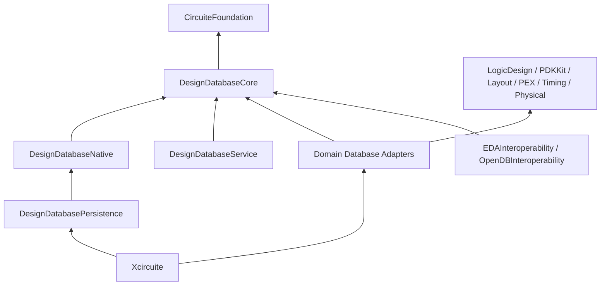

# DesignDatabase

Status: executable reference implementation. Immutable revisions, transactions, exact snapshots, typed queries,
in-memory indexes, full-image WAL persistence, recovery validation, and an in-process service are implemented.
Paged column storage, borrowed record batches, schema generation, CLI, remote transport, and the OpenDB C ABI /
external client are not implemented yet and are tracked explicitly in `REMAINING_TASKS.md`. A pure neutral
object/property/relation adapter is implemented in the sibling `EDAInteroperability` package.

`DesignDatabase` is the canonical working-state store for the LSI semiconductor design platform. It provides
immutable revisions, task-owned transactions, indexed entity and relationship queries, persistence,
change tracking, and an external service surface. It depends on `CircuiteFoundation` and does not own domain
semantics or EDA algorithms.

Arrows represent compile-time dependency from consumer to dependency.

## Products

| Product | Responsibility |
|---|---|
| `DesignDatabaseCore` | public protocols, revision selectors, snapshot, transaction, query, facet registration, typed errors |
| `DesignDatabaseNative` | actor-isolated revision store, copy-on-write values, immutable snapshot indexes |
| `DesignDatabasePersistence` | process ownership lock, checksummed full-image WAL, durable publication, recovery |
| `DesignDatabaseService` | in-process sessions, monotonic leases, schema / capability negotiation |

Planned products `DesignDatabaseSchemaCompiler`, `DesignDatabaseCLI`, and `DesignDatabaseTesting` do not have
callable targets yet. The optimized paged backend will be added beside the safe Native reference backend and must
pass differential tests before it can replace it.

## Non-Responsibilities

- logical, physical, technology, parasitic, and photonic schema semantics;
- placement, routing, DRC, LVS, PEX, timing, and DFT algorithms;
- LEF, DEF, OASIS, GDSII, and SPEF parsing;
- tool trust and process eligibility;
- approval, waiver, resume, and release policy;
- `.xcircuite` run-ledger persistence;
- OpenDB / OpenROAD symbols in Core or Native products.

Domain packages remain independently usable. Database integration is provided by separate adapter targets that
depend on both the domain package and `DesignDatabaseCore`.

See `DESIGN.md` for storage and lifecycle architecture, `INTERFACES.md` for the normative public API design, and
`REQUIREMENTS.md` for implementation and evidence gates.
