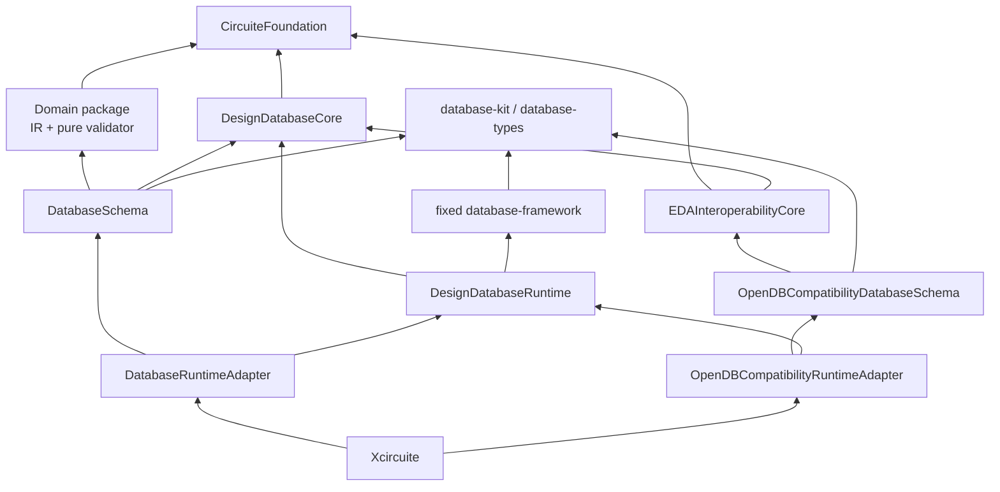
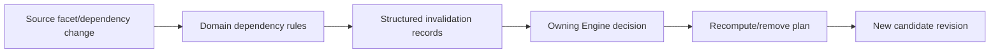

# Schema and Domain Adapter Architecture

Status: normative target design / Logic, PDK-library, and circuit schema-runtime integrations partially implemented.

This document defines the boundary between portable domain packages, host database
schemas, DesignDatabase Runtime, the fixed database stack, and external compatibility.
The dictionary-backed Native schema remains reference behavior only. The first host-only
Logic integration now exercises the fixed-framework Runtime boundary with
content-addressed facet pages, exact-base source-root admission, and deterministic typed
invalidation projection. PDK and standard-cell integrations additionally exercise
locator-free content identity, bounded exact-base cross-facet reads, domain cross-view
validation, and source-content equality. The circuit integration additionally exercises
portable IR product exposure, exact SPICE source identity, ordered terminal/reference
semantics, behavioral-expression projection, and typed exclusion of the separate P1
photonic domain. DesignDatabase now accepts canonical adapter projection changes,
validates reserved entity/relation-occurrence identities, bootstraps an absent family,
inherits unchanged roots, and path-copies exact-base changes in an existing family.
Existing adapters still expose facet documents rather than object-level projection
changes; their mapping, retained execution through the generic paired relation
update/delete validator, migration, and qualification remain target work.

## 1. Ownership

| Layer | Owner | Responsibility |
|---|---|---|
| Shared exact values | `CircuiteFoundation` | Database/revision/entity/schema/capability/content/evidence values |
| Generic declarations and execution | Fixed database stack | Persisted models, fields, relationships, generic indexes, transactions, queries, migrations, and service execution |
| Design state | `DesignDatabase` | Revision/schema/dependency binding, semantic projection pages, changes, candidate publication |
| Domain meaning | Domain package | Database-independent IR, algorithms, invariants, and pure validator |
| Database adaptation | `<Domain>DatabaseSchema` | Framework model declarations, database representation, cross-facet constraints, conversion, bounded overlay adaptation |
| Runtime contribution | `<Domain>DatabaseRuntimeAdapter` | Mechanical contribution to one exact framework registration bundle |
| External compatibility | `EDAInteroperability` | External mapping, compatibility-only schema contribution, and loss evidence |
| Composition | `Xcircuite` | Select and register schema/runtime contributions once; no domain semantics |



No target modifies or extends `database-framework`. No adapter imports `storage-kit`
directly.

## 2. Package Structure

Each domain integration is a separate host-only package:

```text
<Domain>DesignDatabaseIntegration/
├── Package.swift
├── Sources/
│   ├── <Domain>DatabaseSchema/
│   │   ├── <Facet>Models.swift
│   │   ├── <Facet>Bindings.generated.swift
│   │   ├── <Facet>Conversion.swift
│   │   ├── <Facet>ValidationAdapter.swift
│   │   └── <Facet>Migration.swift
│   └── <Domain>DatabaseRuntimeAdapter/
│       └── <Facet>Registration.swift
└── Tests/
```

The portable domain repository retains:

- domain IR and algorithms;
- database-independent pure validation;
- standard parser/serializer logic owned by that domain;
- CircuiteFoundation-only cross-package values.

The domain manifest does not acquire `database-kit`, `database-framework`, a backend,
or a host-only platform baseline.

## 3. Schema Source

`database-kit` model/schema declarations are the generic source of truth. DesignDatabase
does not create a competing table, field, relationship, index, migration, or query
language.

A supplemental design binding manifest may contain only:

- stable facet and design entity-kind IDs;
- mapping from those IDs to framework model/field declarations;
- design semantic projection declarations;
- domain validation/invalidation metadata;
- bounded resource constraints not represented by the generic schema.

Generated bindings may provide:

- stable ID constants;
- typed model/IR conversion;
- snapshot-local handle resolution;
- deterministic schema and binding digests;
- fixtures for cross-language/public contracts.

Generated code is mechanical. It does not contain domain algorithms, migration policy,
backend selection, or external-tool invocation.

## 4. Entity and Field Representation

Each canonical entity declares:

- one stable facet and entity-kind identity;
- one framework persisted model representation;
- explicit scalar fields and bounds;
- explicit relation occurrence models;
- unique constraints;
- semantic projection contributions;
- conversion and validation adaptation.

Implicit runtime defaults are not canonical. Import and facet migration materialize
required values so state interpretation does not depend on the current client version.

Large values are stored as bounded content owners or content-addressed pages. A
control-plane dictionary or `Codable` value is not automatically the hot-path format.

## 5. Relation Occurrences

The reference `Set<DesignEntityID>` representation cannot preserve order, duplicate
targets, edge identity, or edge attributes. The target schema represents every
canonical hierarchy, connectivity, cross-facet, and dependency edge as a stable
occurrence.

An occurrence includes:

- stable nonzero database-wide occurrence ID;
- owner entity;
- relation kind;
- target entity;
- collection/order identity;
- schema-declared typed attributes.

The schema declares:

- optional-one, exact-one, or many cardinality;
- unordered-unique or ordered collection semantics;
- whether repeated targets are permitted;
- forward/reverse semantic projection;
- deletion behavior;
- typed occurrence attributes.

The initial deletion behavior is `restrict`. Hidden cascading delete is not admitted
until its complete semantic change, budget, and domain validation are explicit.

Ordered-many relations use an immutable order-statistics sequence. Semantic ordinal is
derived from rank. A head insertion changes a bounded tree path and does not rewrite
every suffix occurrence or reverse projection row.

## 6. Spatial Projection

Geometry remains domain-owned. The schema projects:

- container;
- explicit `unlayered` or `layer(key)` scope;
- signed DBU conservative bounds;
- entity identity and kind;
- stable nonzero entry ID.

Canonical candidate identity/order is:

```text
(container, layerScope, entity, entryID)
```

The database result is conservative. The physical domain adapter performs exact
geometry refinement and reports its own completion. A candidate result never becomes
an exact DRC/geometry result by naming or fallback.

## 7. Validation Boundary

The ownership is explicit and non-overlapping:

| Validation | Owner |
|---|---|
| Generic persisted type/required/default/reference/relationship/unique/index/migration rules | Fixed `database-framework` |
| Exact revision/schema/dependency/plan binding and atomic publication | `DesignDatabaseRuntime` |
| Database-independent domain meaning and invariants | Domain package pure validator |
| Persistence representation, cross-facet constraint, and overlay-to-domain input adaptation | `<Domain>DatabaseSchema` |
| Expensive whole-design verification | Owning Engine outside commit |

The schema target does not become the semantic owner merely because it invokes the
domain validator. It owns the adaptation from persisted exact proposed state to the
domain validator's typed input.

The Runtime supplies a bounded validation context with:

- exact base and proposed overlay identity;
- the canonical ordered facet-root directory of the exact base revision;
- changed entity/field/occurrence/spatial sets;
- exact schema and dependency roots;
- bounded read/query access;
- cancellation, deadline, work, byte, and result budgets;
- deterministic diagnostic collection.

Validation is side-effect-free. It does not execute external tools, consult clock or
randomness, emit events, or mutate global state. It finishes before candidate
operation claim and is never invoked from a framework retry closure. The adapter returns
an opaque bounded materialization payload. Runtime binds that payload to the exact
segment/schema/adapter/facet identities and persists the resulting validated-mutation
directory atomically with the global operation claim and permanent identity reservation.

After the claim exists, the adapter receives only the persisted validated record, exact
candidate bindings, and reserved identities. Its synchronous materialization method may
decode canonical pages and derive projection changes, but may not read canonical state,
invoke a validator or tool, emit an event, consult clock/randomness, or use a fallback.
The same method is used before and after build-intent publication, so retry behavior has
one deterministic path.

## 8. Schema Evolution

Every design revision pins an exact content-addressed schema bundle. Old revisions
resolve their original descriptor bytes and binding digest.

Two migrations remain distinct:

| Migration | Owner | Result |
|---|---|---|
| Framework persisted application schema migration | Fixed framework during Runtime open | Physical models become compatible before handle publication |
| Design facet migration | Domain schema migrator plus DesignDatabase plan/commit | New candidate revision with new exact schema/data roots |

Framework migration never changes semantic DesignRevision identity. Facet migration
never rewrites an existing revision.

Schema diffs are classified as:

- representation-preserving;
- additive;
- migration-required;
- incompatible.

Classification is evidence, not approval.

## 9. Adapter Interfaces

Use interface segregation rather than one universal adapter.

| Contract | Responsibility |
|---|---|
| Schema provider | Exact framework and design binding contribution |
| Read projector | Exact snapshot to typed view/domain IR |
| Import planner | Domain IR or standard artifact to one-database immutable plan |
| Overlay validation adapter | Bounded proposed state to domain pure-validator input |
| Dependency rule provider | Direct inputs and structured invalidation |
| Facet migrator | Explicit old schema to new candidate plan |
| Exporter | Exact snapshot to deterministic standard artifact |

An import planner does not allocate permanent IDs, write storage, select a backend, or
promote a named reference.

## 10. Dependency and Invalidation

Derived facets record exact source bindings:

- same-database source facet and schema root;
- exact external dependency entry;
- producer and configuration identity;
- input artifact content identities.

A source or dependency update creates structured invalidation records. DesignDatabase
does not silently delete or recompute derived state. The owning Engine and flow policy
decide whether to recompute, reject, waive, or leave the candidate incomplete.



## 11. Runtime Registration

Xcircuite collects selected schema contributions and asks Runtime to build one exact
compiled registration bundle.

Runtime:

1. rejects duplicate DesignDatabase facet, contribution, binding, and semantic
   projection identities;
2. computes the exact registration digest;
3. lets the fixed framework exclusively validate generic model/field/relation/index
   declarations, duplicate generic identifiers, full compiled schema equality, and
   generic runtime requirements;
4. verifies that the persisted DesignDatabase schema bundle expects that contribution;
5. publishes a handle only after physical migration and required model/index readiness.

Runtime adapters only contribute data/handlers. They do not call registration globally,
open a backend, or mutate storage directly.

## 12. External Compatibility

EDAInteroperability maps canonical domain objects through the owning domain schemas. It
does not own a second logical, physical, technology, or timing schema.

Compatibility-only metadata is explicit:

| Data | Owner |
|---|---|
| OpenDB object type/OID/source scope | `EDAInteroperabilityCore` |
| Unknown external property and canonical payload | `OpenDBCompatibilityDatabaseSchema` |
| Semantic loss and acceptance status | `OpenDBCompatibilityDatabaseSchema` plus evidence artifact |
| Canonical cell/net/shape/layer/timing data | Owning domain schema |
| Mechanical Runtime contribution | `OpenDBCompatibilityRuntimeAdapter` |
| One-time composition | `Xcircuite` |

The compatibility Runtime adapter is the only target in that integration allowed to
depend on `DesignDatabaseRuntime`, and it performs mechanical contribution only.
EDAInteroperability never calls storage or mutates a canonical revision directly.

## 13. Persistent Projection Boundary

Domain schema targets declare semantic keys and encoding. DesignDatabaseRuntime owns
the closed persistent page families and keyset traversal. The fixed framework owns model
persistence and transactions.

Adapters do not:

- add generic query sources or planners;
- define raw storage keys;
- return unbounded materialized index results;
- select a backend;
- implement semantic page GC.

Performance extensions remain inside the closed DesignDatabase semantic page model.
If the fixed framework cannot safely express a required operation, that capability is
typed unsupported rather than implemented through a private fork or storage bypass.

## 14. Acceptance Gates

| Gate | Required evidence |
|---|---|
| Package isolation | Portable domain package retains its prior dependency/platform graph and Native/WASM/Embedded build contract |
| Schema equality | Persisted, compiled framework, and design binding schemas match exactly; mismatch fails before handle publication |
| Relation semantics | Cardinality, ordering, duplicate-target, occurrence ID, attributes, forward/reverse projection, and deletion tests |
| Domain round trip | Domain IR → database candidate → exact snapshot → domain IR equality |
| Validation | Bounded delta adaptation produces the same verdict as full pure-domain validation |
| Failure | Invalid conversion/semantic state publishes no candidate |
| Migration | Old revision retains old interpretation; new schema/data are jointly visible in one candidate |
| Dependency | Exact dependency/interface mismatch and structured invalidation tests |
| Spatial | Conservative candidates plus exact refinement and completion tests |
| Runtime registration | Duplicate/missing contribution, framework mismatch, and index readiness failure tests |
| Compatibility | Canonical mapping, external metadata isolation, OID scope, unknown property, and loss tests |
| Performance | Retained domain workload with correctness, latency, memory, allocation, and copy evidence |

No adapter is complete from generated declarations or an empty round trip alone.
